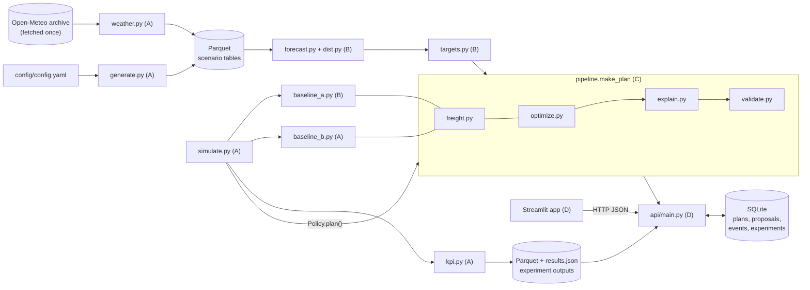

# Architecture.md — Vitaran

Source of truth for *what* to build: `PRD.md`. This file fixes *how* the parts connect: flow, folders, stack, database, API and the module contracts. Who owns what: `Team.md`.

## 1. App flow



**One planning cycle** (PRD §6.5): snapshot → forecast → targets → candidate arcs and curves → MILP solve → load build → validate → reason codes → save and publish.

**Two callers, one pipeline.** The API (live planning) and the simulator (evaluation) both call `engine.pipeline.make_plan()`. No one else calls `optimize`, `validate` or `explain`. Therefore what the judges see in the demo is exactly what was evaluated.

## 2. Folder structure

```
.
├── PRD.md  Architecture.md  Rules.md  Phases.md  Design.md  Team.md  Memory.md
├── config/config.yaml          # every business parameter + assumptions metadata (A)
├── engine/
│   ├── models.py               # CONTRACT: all pydantic models (shared)
│   ├── config.py               # config schema + loader (A)
│   ├── store.py                # CONTRACT: only module touching parquet / SQLite (D)
│   ├── fakes.py                # valid fake objects for every contract (shared)
│   ├── policy.py               # CONTRACT: Policy protocol for the simulator
│   ├── pipeline.py             # make_plan glue, EnginePolicy, re-solve hooks (C)
│   ├── generate.py  weather.py # FR-01, FR-02 (A)
│   ├── simulate.py  kpi.py     # FR-09, KPIs, experiments (A)
│   ├── baseline_b.py           # FR-10 Baseline B (A)
│   ├── forecast.py  dist.py    # FR-03, window distributions (B)
│   ├── targets.py              # FR-04 (B)
│   ├── baseline_a.py           # FR-10 Baseline A (B)
│   ├── optimize.py  freight.py # FR-05, freight + load build (C)
│   ├── validate.py  explain.py # validator, FR-06 (C)
├── api/main.py  api/backend.py # FR-16 + fake/real switch (D)
├── app/streamlit_app.py        # all screens (D)
├── scripts/run_experiments.py  # offline full experiment (A)
├── tests/test_contracts.py     # integration contract tests, run in CI
├── .github/workflows/ci.yml
├── Makefile  requirements.txt  pyproject.toml
└── data/                       # generated, git-ignored
```

## 3. Tech stack

| Layer | Choice | Fallback |
|---|---|---|
| Language | Python 3.11 | — |
| Data | pandas, numpy, pyarrow (parquet) | CSV |
| Database | SQLite (Python stdlib `sqlite3`, WAL mode) | — |
| Forecast | statsforecast (AutoETS, TSB, SeasonalNaive), scipy | Seasonal naive |
| Optimisation | PuLP ≥ 2.8 + HiGHS (highspy) | CBC (bundled with PuLP) |
| Config & contracts | PyYAML + pydantic v2 | — |
| API | FastAPI + uvicorn | In-process calls |
| UI | Streamlit, pydeck, plotly, requests | Static HTML report |
| Parallel runs | multiprocessing, one process per seed | Fewer seeds |
| Tests / CI | pytest, GitHub Actions | — |

## 4. Database

### Decision: Parquet for analytical data, SQLite for app state. No database server.

| Option | Verdict | Why |
|---|---|---|
| **Parquet files** | **Use** for scenario, forecast, simulation and KPI tables | Written once, read in bulk by pandas. Columnar and fast to reload. Reproducibility is easy: same seed gives the same file hash |
| **SQLite** | **Use** for plans, proposals, plan events, experiment jobs | These rows change during the demo: a distributor trims, versions increase, the job status moves. They need transactions, a write lock and version checks (HTTP 409). Ships with Python, zero setup, a single file |
| PostgreSQL / MySQL | Don't use | A server to install on 4 laptops and at the venue adds risk with no benefit at this data size (thousands of rows) |
| MongoDB / Firebase | Don't use | Needs network or accounts; the demo must run offline (Rules.md) |
| DuckDB | Optional later | Handy for ad hoc SQL over parquet; not needed for the product |

Path to production (post-hackathon): swap SQLite for PostgreSQL behind the same `store.py` functions; nothing else changes.

### Rules
- `engine/store.py` is the **only** code that reads or writes files or the database. Everyone calls its functions.
- `store.write_table()` rejects a DataFrame whose columns differ from the contract below. A producer cannot silently break a consumer.
- Engine modules never write SQLite. Only the API and the experiment runner do.

### Parquet tables (`data/…`, contract in `store.TABLES`)

| Table | Path | Producer | Consumers | Columns |
|---|---|---|---|---|
| nodes | `data/<scenario>/` | A | all | node_id, type, city, region, lat, lon, storage_m3, credit_limit_inr, mrsl_fraction, home_depot_id |
| skus | `data/<scenario>/` | A | all | sku_id, name, category, temp_class, shelf_life_days, kg_per_case, m3_per_case, price_inr, landed_cost_inr, margin_inr, disposal_inr |
| lanes | `data/<scenario>/` | A | C, A | from_id, to_id, km, lead_days_mean, p_delay, ftl_cost_amb32_inr, ftl_cost_reef17_inr, ptl_rate_inr_per_kg, ptl_min_charge_inr, co2_kg_per_trip_amb32, co2_kg_per_trip_reef17 |
| lots | `data/<scenario>/` | A | A (snapshot) | lot_id, sku_id, depot_id, qty_cases, mfg_date, expiry_date |
| plant_receipts | `data/<scenario>/` | A | A (sim) | date, lot_id, sku_id, depot_id, qty_cases, mfg_date, expiry_date |
| demand_daily | `data/<scenario>/` | A | B (date < as_of only), A (sim) | date, sku_id, dist_id, true_demand, sold, stockout_flag |
| events | `data/<scenario>/` | A | B | date, region, category, event_type, name, factor |
| weather_daily | `data/` (shared) | A | B, A | date, city, tmax_c, precip_mm |
| forecast | `data/<scenario>/` | B | D (UI) | as_of, sku_id, dist_id, week_start, p10, p50, p90, model, factors_json |
| backtest | `data/<scenario>/` | B | D (UI) | origin, sku_id, dist_id, week_start, horizon, actual, p10, p50, p90, naive |
| targets | `data/<scenario>/` | B | D (UI) | as_of, sku_id, dist_id, S, critical_ratio, z |
| sim_log | `data/experiments/<id>/` | A | A (kpi) | seed, policy, opening_state, date, node_id, sku_id, opening, receipts, sales, lost, expired, credit_cut, closing |
| sim_trips | `data/experiments/<id>/` | A | A (kpi) | seed, policy, opening_state, date, truck_id, mode, from_id, to_id, kg_pct, m3_pct, cost_inr, co2_kg |
| kpi_results | `data/experiments/<id>/` | A | A (summary) | policy, opening_state, seed, kpi, value |
| results.json | `data/experiments/<id>/` | A | D (API) | `ExperimentResults` model |

A scenario id is `seed01` … `seed20`. Each seed's scenario holds history **and** the test window; the forecaster must never read `demand_daily` rows on or after `as_of`.

### SQLite tables (`data/vitaran.db`)

| Table | Key | Columns | Written by |
|---|---|---|---|
| plans | (plan_id, version) | scenario_id, as_of, temp_class, status, created_at, payload (full `Plan` JSON) | API |
| proposals | (plan_id, dist_id) | proposal_version, status, sent_at, responded_at | API |
| plan_events | event_id | plan_id, plan_version, dist_id, actor, action, line_id, old_qty, new_qty, delta_cost_inr, ts | API |
| experiments | experiment_id | config_hash (unique), status, progress_pct, started_at, finished_at, error | API, experiment runner |

Difference from PRD §6.3: plan lines are stored inside the `plans.payload` JSON instead of a separate `plan_lines` table. A version is immutable once saved, so one JSON blob per version avoids keeping two copies in sync.

## 5. API

### 5.1 External APIs

| API | Used? | How |
|---|---|---|
| Open-Meteo Historical Weather (archive) | **Yes, once** | `weather.py` fetches daily max temperature and rain for 16 cities into `weather_daily.parquet`. Free, no key. Never called during experiments or the demo |
| WhatsApp Business / Twilio | No (P2, FR-29) | The distributor inbox is a mock screen on our own API |
| Maps / routing APIs | No | Road km = haversine × 1.3 (A3); pydeck needs no key for arcs over a basic map |
| LLM APIs | No | Reason codes are deterministic rules (PRD §7) |

### 5.2 Our API (FastAPI, `/v1`, docs at `/docs`)

All bodies are models from `engine/models.py`. The first 10 rows are the PRD §6.4 endpoints; the last 7 are additions the screens need (17 in total).

| Method & path | Purpose | Body → Response | Errors |
|---|---|---|---|
| `GET /v1/scenarios/{id}/snapshot?as_of=&opening_state=` | Stock state | — → `Snapshot` | 501 until A's code lands |
| `POST /v1/forecasts` | Weekly forecast + backtest metrics | `ForecastRequest` → `ForecastResponse` | |
| `POST /v1/plans` | New plan, or new version with `base_plan_id` | `PlanRequest` → `Plan` | 500 with violations if the validator fails |
| `POST /v1/plans/{id}/publish` | Mark PROPOSED, one proposal per distributor | `PublishRequest` → `PublishResponse` | 404 |
| `POST /v1/plans/{id}/responses` | Accept / trim / reject, locked re-solve | `ResponseRequest` → `ResponseResult` | **409** stale proposal version; 422 bad line or qty |
| `GET /v1/plans/{id}/dispatch?depot=&version=` | Truck view, lines in FEFO order | — → `DispatchResponse` | |
| `GET /v1/plans/{id}/dispatch.csv?depot=` | Dispatch sheet (UTF-8 with BOM) | — → CSV | |
| `POST /v1/experiments` | Start evaluation job | `ExperimentRequest` → 202 `ExperimentAccepted` | same config hash returns the cached id |
| `GET /v1/experiments/{id}` | Job status | — → `ExperimentInfo` | 404 |
| `GET /v1/experiments/{id}/results` | Cached KPI results | — → `ExperimentResults` | 404 until done |
| `GET /v1/health` *(added)* | Liveness + fake/real backend flag | — → `{status, fake_backend}` | |
| `GET /v1/scenarios` *(added)* | Scenario picker | — → `list[str]` | |
| `GET /v1/plans/{id}?version=` *(added)* | Re-fetch a plan (latest by default) | — → `Plan` | 404 |
| `GET /v1/plans/{id}/proposals` *(added)* | Proposal status per distributor | — → `list[Proposal]` | |
| `GET /v1/plans/{id}/inbox/{dist_id}` *(added)* | One distributor's message (J2 step 1) | — → `Message` | 404 if not published |
| `GET /v1/plans/{id}/events` *(added)* | Change log (J2 step 3) | — → `list[PlanEvent]` | |
| `GET /v1/assumptions` *(added)* | FR-15 table from `config.yaml` | — → `list[AssumptionRow]` | |

Rules:
- **Line ids belong to one version** (`PL-xxxx-v2-017`). After any response, clients re-fetch the latest plan before acting again.
- **Optimistic locking per distributor**: a response carries that distributor's `proposal_version`. A mismatch returns 409; another distributor's response never invalidates it.
- Responses are applied one at a time inside a SQLite `BEGIN IMMEDIATE` transaction.
- An unfinished engine function raises `NotImplementedError`, which the API returns as **501**. The UI shows that error and keeps working.

### 5.3 Fake vs real backend
`api/backend.py` has two classes with identical methods. With `VITARAN_FAKE=1` every endpoint runs on `engine/fakes.py`, so Member D builds and demos the UI from hour 0. Without it, each endpoint calls the real modules. Switching needs no change to the API or the UI.

## 6. Module contracts (frozen at hour 0)

| Function | Owner | Input → Output | Called by |
|---|---|---|---|
| `generate.generate(cfg, seed)` | A | Config, int → scenario_id; writes parquet | Makefile, tests |
| `generate.load_scenario(id)` | A | str → `Scenario` | API, sim |
| `simulate.get_snapshot(id, as_of, opening_state)` | A | → `Snapshot` | API |
| `simulate.run_policy(id, policy, state, seed)` | A | → (sim_log, sim_trips) DataFrames | run_experiment |
| `simulate.run_experiment(exp_id, req, progress)` | A | writes parquet + results.json | API, script |
| `kpi.compute_kpis` / `kpi.summarise` | A | DataFrames → `ExperimentResults` | sim |
| `forecast.forecast(id, as_of, horizon_days, model)` | B | → `ForecastBundle` | API, sim |
| `forecast.backtest(id)` | B | → `BacktestMetrics` | API |
| `dist.window / quantile / expected_shortfall / expected_leftover` | B | mean, var → numbers | C (curves C2, C8) |
| `targets.compute_targets(scenario, forecast, temp_class, settings)` | B | → `list[Target]` | pipeline, baselines |
| `BaselineA().plan(...)` | B | `Policy` → `Plan` | sim |
| `BaselineB().plan(...)` | A | `Policy` → `Plan` | sim, pipeline fallback |
| `freight.ftl_trip_cost / ptl_cost / build_loads` | C | → INR, (lines, trucks) | optimiser **and both baselines** |
| `optimize.solve(OptimizeInput)` | C | → `SolveOutput` | pipeline only |
| `explain.add_reasons(out, inp)` | C | → `Plan` | pipeline only |
| `validate.validate_plan(plan, scenario, snapshot, locks)` | C | → `ValidationReport` | pipeline, tests |
| `pipeline.make_plan(...)` | C | → validated `Plan` with reasons | API, `EnginePolicy` |
| `pipeline.apply_response(...)` | C | → `Plan` (version + 1) | API |
| `store.*` | D | parquet / SQLite I/O | everyone |

## 7. Key design decisions
- One network-wide MILP per temperature class (chilled every 2 days, ambient weekly).
- Lost sales and expected waste are convex piecewise-linear curves, so no extra binaries.
- Every instance is feasible by construction (x = 0); locks come from a validated earlier version.
- If the solver fails, the cycle falls back to Baseline B and the plan is flagged (`solve.status`).
- All policies use the same `freight.py`, the same forecast and the same credit cut, so comparisons are fair.
- All business parameters come from `config.yaml`.
