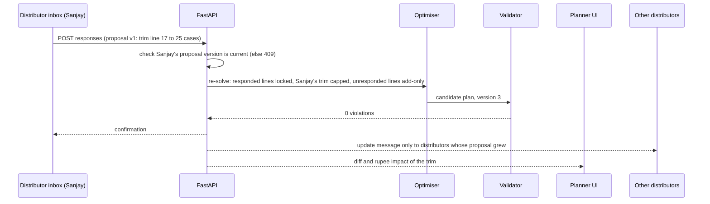
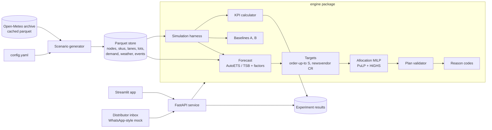

# Vitaran: Distribution Intelligence & Inventory Optimization Engine

**Product Requirements Document · Hackathon Problem Statement 2 · v1.1 · 24 Oct 2026** (changes from v1.0 in Appendix C)

*Vitaran (वितरण) means "distribution".*

## Contents

1. Executive Summary
2. Problem Statement
3. User Personas
4. Core User Journeys
5. Functional Requirements (P0 / P1 / P2)
6. High-Level Architecture & Flow
7. Innovation & Differentiation
8. Success Metrics
9. Assumptions
10. Risks & Mitigations
Appendix A: `config.yaml` excerpt · Appendix B: References · Appendix C: Changes from v1.0

---

## 1. Executive Summary

**Problem.** An FMCG brand holds finite, batch-dated stock in a few company depots (CFAs) and must decide every cycle what to send to many general-trade (GT) distributors. Demand shifts with regional festivals and weather, freight is priced per truck rather than per case, and chilled SKUs expire in 10–21 days. Current tools decide one distributor at a time with rules such as "trailing sales × days of cover − stock", and pick the source depot by proximity. The outcome is stockouts in one region, expiring stock in another, and part-loaded trucks.

**Solution.** Vitaran replaces those separate rules with one network-wide decision per planning cycle:

| Stage | Method | Output |
|---|---|---|
| Forecast | AutoETS baseline × learned festival, promo and weather factors; TSB for intermittent series; empirical residual-quantile bands | P10 / P50 / P90 per SKU × distributor × week |
| Target | Order-up-to level S; service level from each SKU's newsvendor critical ratio | S per SKU × distributor: the reference level shown to planners and used by baselines and reason codes |
| Optimise | Mixed-integer linear program (PuLP + HiGHS): source depot, lot, quantity, FTL trips, PTL, truck class | Shipment lines, each assigned to a truck |
| Explain | Reason codes computed from binding constraints and solution values; faithfulness checked by counterfactual re-solves | 1–2 codes with ₹ figures per line |
| Confirm | Distributor accept / trim / reject; re-solve with locked lines | Final dispatch plan |
| Prove | Seeded 12-week simulation over Diwali 2025; 20 paired seeds; 2 baselines; 6 ablations; 2 opening states | KPI deltas with 90% confidence intervals |

The optimiser minimises one rupee objective: FTL trips + PTL charges + expected lost margin + holding on expected leftover stock + expected expiry (+ an optional carbon price in P1). It is subject to lot stock, truck weight and volume, distributor storage, distributor credit and minimum remaining shelf life (MRSL). Because lost sales are priced by the probability that each extra case sells, scarce stock is spread across distributors rather than given to whichever lanes are cheapest.

**What ships in 24 hours.** A Python engine, a FastAPI service (10 endpoints) and a Streamlit app running on a simulated Indian network: 4 depots, 16 distributors, 24 SKUs, 2 years of daily history driven by real Open-Meteo weather for each city. P0 is split into a core tier that must run end to end by an hour-12 gate and a demo tier built afterwards, with a stated drop order (§5.1). Every parameter lives in `config.yaml` with its source or a "judgment" flag.

**Headline targets** (engine vs the better of two baselines, neutral opening stock, mean of 20 paired seeds; full list in §8):

| Metric | Target |
|---|---|
| Fill rate | ≥ +2 percentage points |
| Wastage ₹ | ≤ −20% |
| Total cost to serve ₹ | ≤ −8% |
| Allocation solve time, p95 | ≤ 2 s |
| Forecast WAPE (SKU × distributor × week) | ≤ 35%, and ≥ 10% better than seasonal naive |

---

## 2. Problem Statement

### 2.1 Operating context

- Indian FMCG goods flow plant → depot/CFA → (super-stockist) → distributor → retailer. General trade (kirana) accounts for roughly 75–90% of FMCG sales, across 12–14 million outlets and 400,000+ distributors (ET BrandEquity; Kotak Insights).
- The brand cannot see kirana shelves. The decisions it controls are **CFA → distributor allocation** and **depot ↔ depot transfers**. Vitaran therefore models depots as supply nodes and distributors as demand nodes, with retailer demand aggregated into each distributor's secondary sales.
- Planning uses **secondary sales** (distributor → retailer). Primary sales (brand → distributor) are inflated by month-end pushes and misstate demand.

### 2.2 How the decision fails today

| # | Current practice | Failure mechanism | Visible symptom |
|---|---|---|---|
| F1 | Split stock by last month's sales | Ignores moving festivals (Diwali fell on 12 Nov 2023, 1 Nov 2024, 20 Oct 2025) and region-specific festivals | Pre-festival stockouts in one region, post-festival excess in another |
| F2 | Ship from the nearest depot, issue FIFO | A lot's remaining shelf life (RSL) is never compared with the destination's sell-through speed | Short-dated lots expire at slow distributors; return claims |
| F3 | Allocate first, book trucks afterwards | Freight is a step function: a truck costs the same 30% or 100% full, and per-km rates fall with distance. FR8 market rates for 32 ft SXL trucks run from ≈ ₹67/km (Delhi–Jaipur, 280 km) to ≈ ₹42/km (Mumbai–Delhi, 1,414 km) | Part-loaded trucks; PTL used where topping up a booked truck would cost nothing extra |
| F4 | One service level (e.g. 95%) for every SKU | Over-protects perishables whose overage cost is high; under-protects long-life SKUs | Dairy over-stocked and wasted; detergents out of stock |
| F5 | Push plans that ignore distributor finances | GT distributors buy on advance payment or short credit | Shipments refused or unpaid; plan diverges from what actually ships |
| F6 | Spreadsheet or black-box output | The planner cannot see why a line exists | Manual overrides undo the plan |

### 2.3 Impact evidence

| Figure | Value | Source |
|---|---|---|
| Logistics cost in India | ≈ 7.97% of GDP | DPIIT–NCAER, via Economic Times |
| Long-run FMCG out-of-stock rate (global) | ≈ 8.3% | Gruen & Corsten, via POMS (2014) |
| FMCG products off-shelf, mature European markets, 2022 | ≈ 4% | NielsenIQ |
| Enterprise planning suite TCO (Blue Yonder, 3 years) | $500K to several $M | FarEye |
| Packaged-FMCG expiry write-off rate in India | **No credible public figure found** | Distributor federations are seeking a disposal SOP and object to 90-day caps on expiry claims (NDTV Profit) |

Enterprise suites (SAP IBP, o9, Blue Yonder, Kinaxis) handle network deployment but are priced for large enterprises. The Indian DMS/SFA tools reviewed (Bizom, FieldAssist, Salesforce Consumer Goods Cloud) publicly describe per-distributor suggested orders, not multi-depot sourcing with freight and expiry trade-offs. Every algorithmic component Vitaran needs is open source. The gap this product targets is **price and explainability** for mid-market brands (defined in §2.7), not the absence of the technique.

**Worked example: what the problem costs one archetype brand.** No public source sizes these costs for a single Indian mid-market brand, so the table below is built from stated judgment values. It is illustrative, not a forecast; its purpose is to show the order of magnitude and to set the ceiling for pricing (§7.5).

| Item | Value | Basis |
|---|---|---|
| Brand | ₹1,000 cr revenue a year, 80% through GT; 6 CFAs, 300 distributors, 150 SKUs | Midpoint of the target segment (§2.7); judgment |
| Secondary freight (CFA → distributor) | 2.5% of revenue ≈ ₹25.0 cr | Judgment |
| Lost margin from stockouts | 4% of GT demand × 35% gross margin ≈ ₹11.2 cr | 4% sits between the NielsenIQ (≈ 4%) and Gruen & Corsten (≈ 8.3%) figures above; margin is judgment |
| Expiry write-off | 1.0% of revenue ≈ ₹10.0 cr | No public figure (table above); judgment, range 0.5–2% |
| Holding | 30 days of network stock at cost (65% of revenue) × 20% a year ≈ ₹10.7 cr | A18; days of stock and cost share are judgment |
| **Cost to serve** (the §8.2 KPI definition) | **≈ ₹56.9 cr a year** | Sum |
| If the neutral-start target (−8%) transferred | ≈ ₹4.6 cr a year | Applies §8.2; real transfer is what the pilot (§8.6) tests |

### 2.4 Problem statement

> Given batch-level depot stock, distributor stock and in-transit units, a probabilistic demand forecast, lane costs and node constraints, choose each cycle's shipments (**SKU, lot, source depot, destination distributor, quantity, truck**) that minimise total cost to serve (freight + lost margin + expired value + holding, optionally + carbon), within stock, truck, storage, credit and shelf-life limits, and give every line a reason the planner can verify.

### 2.5 Scope boundaries

- **In scope:** depot → distributor allocation, source-depot choice, lot choice, truck class and FTL/PTL mode, distributor confirmation, offline evaluation.
- **Out of scope (MVP):** plant production planning, retailer-level replenishment, intra-city route sequencing, pricing and trade-promotion design, live ERP/DMS integration.

### 2.6 Traceability to the problem statement

| PS clause | Where it is addressed |
|---|---|
| "analyse available inventory" | Lot-level snapshot (§6.3), FR-05 |
| "estimated demand" | FR-03 forecast with WAPE, bias and interval coverage |
| "distribution constraints" | Optimiser constraints C1–C10 (§6.6.3) |
| "which products … which locations … what quantities … which warehouses" | Plan line schema (§6.4) |
| "minimise stockouts / unnecessary transportation costs / inventory wastage" | Objective terms (§6.6.3); KPIs (§8.2) |
| "best possible use of available stock" | Shortage allocation by expected lost margin: each extra case at a distributor is worth π × P(it sells), so scarce stock spreads to where it is most likely to sell (§6.6.3, C2); optional fair-share floor; P1 rebalancing (FR-18) |
| "demonstrates how its decisions can improve supply-chain efficiency" | FR-09 to FR-12: simulation, baselines, ablations, frontier |
| "realistic simulated datasets … assumptions clearly stated" | FR-01, FR-15, §9 |
| "regional demand … product shelf life" | Regional festival calendars, city weather, category shelf lives, MRSL rule |
| "multiple warehouses, distributors, and retail stores" | 4 depots, 16 distributors; retail demand aggregated (stated in §9) |

### 2.7 Target segment

| Attribute | Definition |
|---|---|
| Revenue | ₹300–3,000 cr a year |
| Channel | ≥ 60% of sales through general trade |
| Network | 3–10 depots/CFAs; 100–800 distributors |
| Portfolio | Mix of ambient and short-life SKUs (dairy, fresh snacks, beverages), so expiry and freight trade off |
| Systems | Uses a DMS (e.g. Bizom, FieldAssist) and an ERP; no enterprise planning suite |
| Why this band | Too many depot × distributor × lot combinations to plan well in a spreadsheet; too small to justify enterprise-suite cost (§2.3) |

Segment size is not yet quantified: we found no public count of Indian FMCG brands in this band. Validating it, with the brand's own data in the pilot, is a post-hackathon task. The personas in §3 are composites built from the failure modes in §2.2, not from interviews; the pilot metrics in §8.6 are designed to test them.

---

## 3. User Personas

### P1 · Priya, Central Supply Planner (HQ, Mumbai). Primary user

- **Job:** Publishes the deployment plan from 4 CFAs to all distributors. In the demo network that is 384 SKU × distributor pairs and about 3,500 lot-to-distributor options per cycle.
- **Today:** Exports DMS stock, edits an Excel allocation sheet, phones depots for lot dates. Diwali weeks need repeated manual re-plans.
- **Pains:** Cannot see which lots will expire where; cannot quantify the freight-vs-service trade-off; is blamed for both stockouts and write-offs.
- **Needs:** A plan in seconds, a reason for every line, a slider that trades service against cost, a diff when inputs change.
- **Success signal:** Accepts ≥ 70% of lines without edits (pilot metric, §8.6).

### P2 · Sanjay, GT Distributor Owner (Nagpur)

- **Job:** Serves several hundred kirana outlets; buys from the brand within a credit limit; runs ordering and collections on WhatsApp.
- **Pains:** Receives stock with little shelf life left; expiry claims are capped and slow; runs out of fast SKUs before Diwali while slow SKUs tie up godown space and credit.
- **Needs:** A proposed order showing value against available credit and shelf life on arrival, with the ability to trim lines.
- **Success signal:** Trims ≤ 20% of proposed lines; zero lines arrive below MRSL.

### P3 · Ramesh, CFA Dispatch Manager (Bhiwandi)

- **Job:** Picks, loads and dispatches trucks from the depot each day.
- **Pains:** Plans arrive as SKU totals, not truck loads; the wrong lot gets picked; trucks leave part-full.
- **Needs:** A truck-wise sheet: truck class, destination, load % by weight and volume, lot-wise pick list in FEFO order, ship date.
- **Success signal:** Mean FTL utilisation ≥ 85%; no lot substitutions needed at loading.

### P4 · Anita, Head of Supply Chain. Buyer and approver

- **Job:** Owns cost to serve, write-offs and service level; approves tools; contributes to the company's SEBI BRSR sustainability disclosures.
- **Pains:** Vendor savings claims she cannot verify; enterprise suites priced for much larger firms.
- **Needs:** Results on identical demand against fair baselines, ablations showing where savings come from, carbon per case, inspectable assumptions.
- **Success signal:** The 90% confidence interval on the cost-to-serve difference excludes zero in both opening states.

---

## 4. Core User Journeys

### J1 · Weekly deployment plan (Priya, Monday 09:00)

| Step | User action | System response | API / data | Latency budget |
|---|---|---|---|---|
| 1 | Opens **Plan** tab; picks scenario and as-of date | Loads lots, distributor stock, in-transit, credit available | `GET /v1/scenarios/{id}/snapshot` | ≤ 2 s |
| 2 | Reviews **Forecast exceptions** | Lists pairs with festival, heat or rain factor ≥ 1.15 (or ≤ 0.85), and pairs with backtest WAPE > 50% | `forecast` table | ≤ 1 s |
| 3 | Clicks **Generate plan** | Forecast → targets → optimiser → validator → reason codes. Shows plan table, map arcs, expected KPIs | `POST /v1/plans` | ≤ 5 s end to end |
| 4 | Moves the stockout-weight slider (carbon-price slider too when FR-13 is built) | Re-solves; diff view highlights changed lines and the ₹ change in expected cost | `POST /v1/plans` (new version) | ≤ 3 s |
| 5 | Clicks **Send to distributors** | Plan status → PROPOSED; one message per distributor | `POST /v1/plans/{id}/publish` | ≤ 1 s |

**Exit:** plan is PROPOSED and 100% of lines carry a reason code.

### J2 · Distributor confirmation (Sanjay)

| Step | User action | System response | API / data | Latency budget |
|---|---|---|---|---|
| 1 | Opens his message in the **Distributor inbox** (WhatsApp-style panel) | Shows his proposal (proposal version 1): each line's SKU, cases, RSL on arrival, ETA, ₹ value; total ₹3.2 lakh vs ₹4.0 lakh credit available | `plan_lines`, `proposals` | ≤ 1 s |
| 2 | Trims paneer from 40 to 25 cases; accepts the rest | His accepted lines are fixed and the trimmed line is capped. Lines of distributors who have not responded can only grow; responded distributors are untouched. The 15 freed cases go to a non-responded distributor (whose proposal version rises and who gets an update message) or stay at the depot | `POST /v1/plans/{id}/responses` | ≤ 3 s |
| 3 | (Priya) Opens change log | Shows distributor, line, Δ cases and Δ ₹ expected cost of the trim, and which proposals grew | `plan_events` | ≤ 1 s |

**Exit:** every distributor has responded (ACCEPTED / TRIMMED / REJECTED), or the response window closes and Priya decides. Priya can trigger a full re-plan at any time, which issues new proposals to everyone; that is the only path that can reduce a proposal a distributor has not yet answered.



### J3 · Dispatch (Ramesh)

| Step | User action | System response | API / data | Latency budget |
|---|---|---|---|---|
| 1 | Opens **Dispatch** tab filtered to his depot | Truck cards: truck ID, class, destination, kg % and m³ %, lots in FEFO pick order | `GET /v1/plans/{id}/dispatch?depot=W1` | ≤ 2 s |
| 2 | Downloads the sheet | CSV, one row per truck × lot | `GET /v1/plans/{id}/dispatch.csv` | ≤ 1 s |

**Exit:** every shipped case is assigned to a truck ID or a PTL consignment ID.

### J4 · Evaluate before adopting (Anita; also the judging demo)

| Step | User action | System response | API / data | Latency budget |
|---|---|---|---|---|
| 1 | Opens **Results**; picks opening state (neutral / imbalanced) | KPI cards for engine, Baseline A and Baseline B: mean and 90% CI over 20 seeds; paired delta vs the better baseline | `GET /v1/experiments/{id}/results` (cached) | ≤ 3 s |
| 2 | Opens **Frontier** | Fill rate vs cost to serve, one curve per policy | cached | ≤ 2 s |
| 3 | Opens **Ablation** | ₹ contribution of the expiry term, truck steps, forecast, credit constraint, per-SKU service levels and multi-depot sourcing | cached | ≤ 2 s |
| 4 | Opens **Assumptions** | `config.yaml` rendered with value, unit, source or judgment flag | `config.yaml` | ≤ 1 s |

**Exit:** decision to run a 4-week shadow pilot.

---

## 5. Functional Requirements

### 5.1 P0: Must-have (built and demoed within 24 hours)

P0 has two tiers. **P0-core** proves the engine works and must run end to end at the hour-12 gate. **P0-demo** proves it to judges and is built between hours 12 and 18. FR-13 (carbon) moved to P1 in v1.1.

| Tier | Requirements | Gate | Gate test |
|---|---|---|---|
| P0-core | FR-01, 02, 03, 04, 05, 06, 07, 09, 10; FR-16 snapshot, plans and dispatch endpoints | Hour 12 | One seed × 84 days, engine and both baselines: 0 validator violations, 0 conservation failures, every line coded. A 3-seed smoke run then measures solve time (extrapolated experiment run time) and baseline KPI levels (§8.2) |
| P0-demo | FR-08, 11, 12, 14, 15; remaining FR-16 endpoints | Hour 18 | Full experiment cached; every demo screen loads from cache |

**Drop order if the hour-12 gate slips.** Cut from the top until the remaining work fits before hour 18:
1. FR-14 map → static lane table filtered by reason code.
2. FR-11 frontier → 3 points per policy instead of 4–5.
3. FR-12 ablations → keep (a) expiry term, (b) truck steps and (e) service levels; drop (c), (d), (f).
4. FR-08 inbox UI → trim demonstrated through the API at `/docs`; the re-solve logic stays.
5. Seeds → 10 instead of 20 (wider confidence intervals, reported as such).

Never cut: the validator, the conservation assertion, both baselines, reason codes, both opening states.

**FR-01 · Scenario generator** · *P0-core*
- **Spec:** Builds network, SKUs, lots, 2 years of daily demand history (25 Sep 2023 – 28 Sep 2025) and a 12-week test window (29 Sep – 21 Dec 2025, covering the end of Durga Puja and all of Diwali) from `config.yaml` and a seed. Daily demand = base × region × weekday × season × festival × promo × weather × negative-binomial noise. Stores true demand separately from sales, with a stockout flag. Adds effects the forecaster does not model (unannounced promos, one regional demand shock) so forecast accuracy is not inflated.
- **Acceptance:** Same config and seed produce identical parquet hashes; generation ≤ 60 s; config validated by pydantic, failing with the offending field name.

**FR-02 · Weather data** · *P0-core*
- **Spec:** Daily maximum temperature and precipitation for the 16 distributor cities from the Open-Meteo Historical Weather (archive) API, fetched once and cached to `data/weather.parquet`. The generator uses it as a demand driver (heat for beverages and dairy, heavy rain for GT footfall). In the test window the forecaster receives actual weather plus noise (σ = 2 °C; ±30% on rainfall) for the next 7 days in place of a weather forecast, and city × week-of-year climatology from the history beyond day 7, so it has no perfect foresight.
- **Acceptance:** App and experiments run with the network disabled; the fetch script is idempotent.

**FR-03 · Demand forecast** · *P0-core*
- **Spec:** Weekly SKU × distributor series.
  1. Classify each series by ADI and CV² (Syntetos–Boylan: ADI > 1.32 is intermittent or lumpy).
  2. Intermittent and lumpy series → TSB. Smooth and erratic series → AutoETS, fitted on series where festival and promo weeks are replaced by fitted values.
  3. Multiplicative factors: festival and promo uplift = median(actual ÷ baseline) per category × event × region. Weather elasticities β (heat) and γ (rain) per category from OLS of log(actual ÷ baseline) on weekly heat excess and heavy-rain days, using non-event weeks.
  4. P10 / P50 / P90 from empirical quantiles of rolling-origin backtest residuals per category × horizon.
  5. Each forecast row stores its factors for explanation (e.g. "Diwali ×1.45, heat ×1.08").
  6. Weekly forecasts are converted to daily and window distributions as specified in §6.6.1.
- **Acceptance:** All 384 pairs × 4-week horizon (covers the 14-day festival look-ahead) in ≤ 30 s for a parameter refit and ≤ 3 s for a weekly state update; backtest report with WAPE, bias and P10–P90 coverage against seasonal naive; factors visible in the UI; window distributions pass the §8.5 linearisation test.

**FR-04 · Target levels** · *P0-core*
- **Spec:** S = μ(R+L) + z(CR)·σ(R+L), with μ and σ derived from the forecast quantiles. CR = Cu ÷ (Cu + Co), where Cu = 1.2 × unit margin and Co = holding cost over the cycle + P(expiry before sale) × (landed + disposal cost) × claim share. CR is clipped to [0.30, 0.98]. Review period R = 7 days for ambient, 2 days for chilled. S is the level the optimiser would choose for a pair if stock, freight, storage and credit were unconstrained. The optimiser does not impose it (§6.6.3); it is shown to the planner and used by the baselines, the cover-extremes KPI and the reason codes.
- **Acceptance:** Every chilled SKU has a lower CR than every ambient SKU of similar margin; targets table persisted per cycle.

**FR-05 · Allocation optimiser** · *P0-core*
- **Spec:** The model in §6.6.3. Solved separately per temperature class (chilled every 2 days on reefer trucks, ambient weekly on 32 ft trucks or PTL). Lot-level decisions; integer FTL trips; PTL with minimum charge; expected lost sales priced per distributor and expected expiry priced per lot × destination; distributor storage and credit; MRSL arc filter; MRSL-cliff penalty at the depot; optional fair-share floor. Solved with HiGHS through PuLP; CBC fallback; 30 s time limit; 1% MIP gap.
- **Acceptance:** An independent validator re-checks every plan: 0 violations of lot stock, truck kg and m³, storage, credit and MRSL. p95 solve ≤ 2 s (ambient) on the demo instance. Every instance is feasible by construction (§6.6.3). On a hand-built scarcity test (one SKU, 2 depots, 4 distributors, stock = 60% of total demand), every distributor with positive demand receives stock unless the freight to serve it exceeds the expected margin the shipment recovers; the same instance under v1.0's linear shortfall penalty is kept as a regression test showing the difference. On timeout it returns the best incumbent and logs the gap.

**FR-06 · Reason codes** · *P0-core*
- **Spec:** Rules in §6.6.4, computed from the solution, constraint slacks and input parameters (no dual values). Up to 2 codes per line, ordered by ₹ impact, rendered with fixed templates that include the numbers. Unfilled demand appears as rows with zero shipment and a limiting code.
- **Faithfulness check:** codes are rules applied after the solve, so they are tested against counterfactuals. For 20 random lines per test plan, the arc behind the line is removed and the model re-solved. The code passes if the re-solve moves cost in the direction the code states (e.g. removing a `CHEAPEST_SOURCE` line raises freight; removing an `EXPIRY_PUSH` line raises expected expiry). This runs offline in the test suite (about 40 s per plan), not in the live API.
- **Acceptance:** 100% of lines have ≥ 1 code; each code has a unit test on a hand-built 2-depot × 2-distributor instance where the correct code is known; counterfactual agreement ≥ 90% (§8.5).

**FR-07 · Plan and dispatch outputs** · *P0-core*
- **Spec:** Plan table columns: SKU, lot, expiry, from, to, cases, truck ID, truck class, ship date, ETA, RSL on arrival, allocated freight ₹, reason codes, status. Lines are assigned to trucks by the load-build step and freight is allocated by each line's share of the truck (§6.5, step 7). Truck view groups lines per truck with kg % and m³ %. CSV export.
- **Acceptance:** kg and m³ per truck never exceed capacity; every shipped line has a truck ID or PTL consignment ID; allocated freight per truck sums to the trip cost; CSV opens in Excel without fixes (UTF-8 with BOM).

**FR-08 · Distributor confirmation loop (WhatsApp-style mock)** · *P0-demo*
- **Spec:** One inbox panel per distributor showing lines, total value vs available credit, and RSL on arrival. Actions: accept, trim (new quantity ≤ proposed), reject. Each distributor's proposal carries its own version. A response is checked only against that distributor's proposal version, so one distributor's response never invalidates another's. The re-solve fixes accepted lines, caps trimmed lines, lets lines of distributors who have not responded only grow, and leaves responded distributors untouched (constraint C10). Freed stock that no one can absorb stays at the depot. Every response is logged in `plan_events`.
- **Acceptance:** Re-solve ≤ 3 s through the API; no other distributor is pushed past its credit or storage; no line of a distributor who has not responded ever decreases without a planner re-plan; HTTP 409 is returned only when the responding distributor's own proposal version is stale; the ₹ impact of each trim is shown to the planner.

**FR-09 · Simulation harness** · *P0-core*
- **Spec:** Daily loop in §6.6.5 over the 84-day test window. Common random numbers: identical demand, delay and promo draws for every policy within a seed. 20 seeds. Two opening states:
  - *Imbalanced:* one depot holds snack lots at 62–70% RSL (just above the 60% MRSL floor), one region is short before Diwali, one distributor is overstocked on slow SKUs.
  - *Neutral:* every node starts at forecast × target cover.
  Distributor credit evolves: invoices add to outstanding; payments arrive 7 days after the distributor's sales. At dispatch, the simulator checks every policy's shipments against that day's credit available and cuts any excess pro rata across the distributor's lines; cut cases stay at the depot and are logged as `credit_cut`. The same rule applies to the engine, both baselines and every ablation, so a policy that ignores credit pays for it in simulation.
  Headline results use 20 seeds; ablations and frontier points use the first 10 seeds (paired with the same seeds of the full engine) to fit the run-time budget (§6.7).
- **Acceptance:** Stock conservation (opening + receipts − sales − expiry = closing) asserted on every node × SKU × day with 0 failures; full experiment ≤ 25 min on 8 cores (hard cap 30 min); results cached to parquet.

**FR-10 · Baselines** · *P0-core*
- **Spec:**
  - **Baseline A, proportional fair share:** each depot splits stock of a SKU across its home-region distributors in proportion to trailing 4-week sales, capped at target cover. FIFO issue. Each lane uses whichever of FTL or PTL is cheaper for the load.
  - **Baseline B, nearest-depot (s, S) reorder with FTL rounding:** a distributor orders up to S when its inventory position falls below s (95% service level on the same forecast), served first-come-first-served in a seed-randomised order from the nearest depot with stock. FEFO issue. Loads ≥ 70% of a truck are topped up to full with the highest-velocity SKUs; lighter loads go PTL.
  - Both baselines use the engine's forecast and obey the same stock, truck, storage and credit limits (orders above available credit are cut pro rata).
- **Acceptance:** Definitions documented in the README; unit test confirms identical constraint enforcement across policies.

**FR-11 · Results dashboard and frontier plot** · *P0-demo*
- **Spec:** KPI cards (§8.2) per policy with mean and 90% CI, plus paired delta vs the better baseline. Frontier plot of fill rate vs cost to serve: the engine sweeps the stockout-penalty multiplier {0.25, 0.5, 1, 2, 4}; Baseline B sweeps service level {80, 90, 95, 98, 99.5%}; Baseline A sweeps cover days {7, 10, 14, 21}. Frontier points other than each policy's default run on 10 seeds (FR-09). Festival-week fill rate is shown separately from the 84-day figure. At least one KPI that worsens under the engine is shown with its cause.
- **Acceptance:** Every number on screen traces to a row in `kpi_results`; the opening-state toggle updates all charts.

**FR-12 · Ablations** · *P0-demo*
- **Spec:** Engine variants on the same seeds, each switching off one mechanism:
  - (a) no expiry term (ω = 0, no cliff penalty);
  - (b) no truck steps (freight priced per kg, no integer trips);
  - (c) seasonal-naive forecast;
  - (d) no credit constraint (the simulator still cuts shipments above credit, FR-09);
  - (e) uniform service level: π_p set so that π_p ÷ (π_p + h_p) = 0.95 for every SKU, matching Baseline B, with all other terms unchanged;
  - (f) home-depot sourcing only: each distributor's candidate set is its home depot.
  Shown as a waterfall of ₹ cost-to-serve contribution, with fill rate and wastage alongside.
- **Acceptance:** Contributions reported with 90% CIs; variants differ from the full engine only in the switched component (config diff logged).

**FR-14 · Network map** · *P0-demo*
- **Spec:** pydeck map with depots and distributors; arc width ∝ cases; arc colour = primary reason code; depot bubble size ∝ stock within 10 days of the MRSL floor.
- **Acceptance:** Renders ≤ 2 s; clicking an arc filters the plan table to that lane.

**FR-15 · Assumptions tab** · *P0-demo*
- **Spec:** Renders `config.yaml` as a table: parameter, value, unit, source or "judgment" flag, one-line rationale.
- **Acceptance:** Every business parameter used by the generator or engine appears; a test asserts engine modules read business parameters only from config.

**FR-16 · Service API** · *P0-core for snapshot, plans and dispatch endpoints; P0-demo for the rest*
- **Spec:** FastAPI with pydantic v2 models shared with the engine; OpenAPI docs at `/docs`; endpoints in §6.4. The Streamlit app and the distributor inbox call the same API.
- **Acceptance:** Contract tests for every endpoint; stale proposal versions are rejected with HTTP 409; `POST /v1/experiments` returns 202 with a job ID within 1 s.

### 5.2 P1: Should-have (only after P0 runs end to end; scope freeze at hour 18)

Listed in build order. FR-13 is first because it is about 1 hour and supports the buyer persona's BRSR reporting.

| ID | Feature | Why it matters | Effort |
|---|---|---|---|
| FR-13 | Carbon accounting and carbon price (moved from P0 in v1.1; spec below) | Lets the buyer report CO₂ per case and trade it against cost | ~1 h |
| FR-17 | Multi-drop milk runs: 2–3-stop routes per region added as candidate lanes; optimiser chooses routes and load per stop | Raises truck fill without holding extra stock; attacks failure F3 directly | ~3 h |
| FR-18 | Lateral rebalancing: distributor ↔ distributor (via company credit note) and depot ↔ depot moves, each with ₹ benefit | Fixes "excess here, shortage there" with stock already in the network | ~3 h |
| FR-19 | What-if panel: regional demand shock, depot outage, diesel +10% (raises the fuel share of FTL and reefer trips, ≈ +5% on a 700 km FTL trip, and PTL slabs by fuel_share × 10%) | Shows the three PS objectives trading off live | ~2 h |
| FR-20 | Near-expiry at-risk list: units whose RSL is below expected days to sell, with suggested action | Leading indicator for wastage | ~1 h |
| FR-21 | Drill-down: stock trajectory of one SKU × distributor under engine vs baselines | Makes an aggregate KPI gain concrete | ~1 h |
| FR-22 | Planner line override with ₹ cost of the override | Human-in-the-loop control for the planner | ~2 h |
| FR-23 | Second evaluation window: Apr–Jun 2025 heat season | Shows the weather factor where it has most effect | ~1 h |
| FR-24 | Scale benchmark: timed solve at 20 depots × 400 distributors × 200 SKUs with region-wise decomposition | Answers "does it scale" with a measured number | ~1 h |

**FR-13 · Carbon accounting** · *P1*
- **Spec:** kg CO₂ per trip = km ÷ km-per-litre(truck class) × 2.68 kg CO₂ per litre of diesel, using the same mileage as the freight fuel cost (A11, A12). PTL emissions are allocated per kg-km from a 60%-loaded carrier truck. A carbon-price slider λ (₹0–10 per kg CO₂, default 0) enters the objective. KPI: kg CO₂ per case delivered.
- **Acceptance:** λ = 0 yields plans identical to the model without the carbon term; the CO₂ KPI is reported for every policy.

### 5.3 P2: Nice-to-have (post-hackathon)

Ordered by what a shadow pilot (§8.6) would need first.

| ID | Feature | Why it waits |
|---|---|---|
| FR-26 | Messy distributor Excel ingestion: fuzzy SKU matching (rapidfuzz) and data-staleness flag | First pilot blocker, but needs real brand files to build against |
| FR-32 | Forecaster validation on public data (Favorita; FreshRetailNet-50K for censored perishable demand) | Strengthens the forecast claim; dataset prep exceeds the 24 h budget |
| FR-28 | Two-stage stochastic program over 10–20 demand scenarios; 2–3-week time-indexed model for festival pre-build | Removes the single-period limit (A26); 10–20× larger model needs decomposition work |
| FR-31 | Learn penalty weights from accept / trim / override logs (inverse optimisation) | Needs weeks of real response logs that only a pilot produces |
| FR-30 | Liquidation channels for stock that cannot be saved: HoReCa buyers, discount outlets, quick-commerce flash sales, food donation | Needs buyer price data and partner agreements |
| FR-29 | Real WhatsApp Business API / Twilio integration for FR-08 | Business verification and message-template approval take longer than the event |
| FR-33 | E-way bill tagging and invoice bundling per shipment | Requires GST system access; no effect on allocation decisions |
| FR-27 | Global LightGBM forecaster with SHAP driver attributions | M5 results show limited gain over simple methods at this grain; revisit once real data shows where ETS falls short |
| FR-25 | Natural-language Q&A in which an LLM maps a question to scenario parameters and narrates reason codes; it never outputs quantities itself | Presentation layer only; adds no decision quality |
| FR-34 | Quick-commerce dark-store nodes as a second demand channel | Different replenishment rhythm and data source; a separate scope |

### 5.4 Explicitly excluded

Plant production scheduling, retailer-level ordering, in-city vehicle routing, price and promotion optimisation, live ERP/DMS connectors, user authentication beyond a demo role switch.

---

## 6. High-Level Architecture & Flow

### 6.1 Component view



### 6.2 Tech stack

| Layer | Choice | Reason | Fallback |
|---|---|---|---|
| Language | Python 3.11 | All required libraries are native | — |
| Data | pandas, numpy, pyarrow (parquet) | Columnar storage, fast reload for the UI | CSV |
| Forecast | statsforecast (AutoETS, TSB, SeasonalNaive) | Fits 384 series in seconds; standard intermittent-demand methods | Seasonal naive |
| Optimisation | PuLP ≥ 2.8 with HiGHS (highspy) | Readable model code; HiGHS is a fast open-source MIP solver | CBC (bundled with PuLP) |
| Config & contracts | PyYAML + pydantic v2 | Validated config; one set of models for engine and API | — |
| API | FastAPI + uvicorn | Typed endpoints with generated OpenAPI docs | In-process function calls |
| UI | Streamlit, pydeck, plotly | Fastest route to an interactive app with a map | Static HTML report |
| Parallel runs | Python multiprocessing, one process per seed | 20 seeds across 8 cores | Fewer seeds |
| Tests | pytest | Reason codes, validator, conservation, waste curve | — |
| Weather | Open-Meteo Historical Weather API, fetched once | Free, no key, real city-level history | Synthetic seasonal temperature |

### 6.3 Data model

| Table | Grain | Key columns |
|---|---|---|
| `nodes` | depot or distributor | node_id, type, city, region, lat, lon, storage_m3, credit_limit_inr, mrsl_fraction |
| `skus` | SKU | sku_id, category, temp_class (ambient / chilled), shelf_life_days, kg_per_case, m3_per_case, price_inr, landed_cost_inr, margin_inr, disposal_inr |
| `lanes` | depot → distributor | from_id, to_id, km, lead_days_mean, p_delay, ftl_cost_inr by truck class, ptl_rate_inr_per_kg, co2_kg_per_trip |
| `lots` | lot at depot | lot_id, sku_id, depot_id, qty_cases, mfg_date, expiry_date |
| `demand_daily` | date × SKU × distributor | true_demand, sold, stockout_flag |
| `events` | date × region × category | event_type (festival / promo / shock), factor |
| `weather_daily` | date × city | tmax_c, precip_mm |
| `inventory_snapshot` | as_of × node × lot | qty_on_hand, qty_in_transit, eta |
| `forecast` | as_of × SKU × distributor × week | p10, p50, p90, factors_json, model (AutoETS / TSB) |
| `targets` | as_of × SKU × distributor | S, critical_ratio, z |
| `plan_lines` | plan_id × version × line | sku_id, lot_id, from_id, to_id, cases, truck_id (or PTL consignment_id), truck_class, ship_date, eta, rsl_on_arrival_days, freight_alloc_inr, reason_codes, proposal_version, status |
| `proposals` | plan_id × distributor | proposal_version, status (PROPOSED / ACCEPTED / TRIMMED / REJECTED / EXPIRED), sent_at, responded_at |
| `plan_events` | plan_id × event | actor, action (accept / trim / reject / override / grow), line_id, old_qty, new_qty, delta_cost_inr, ts |
| `sim_log` | seed × policy × date × node × SKU | opening, receipts, sales, lost, expired, credit_cut, closing |
| `experiments` | experiment | experiment_id, config_hash, status, progress_pct, started_at, finished_at |
| `kpi_results` | experiment × policy × seed × KPI | value |

### 6.4 API contracts

| Method & path | Purpose | Request | Response |
|---|---|---|---|
| `GET /v1/scenarios/{id}/snapshot?as_of=` | Current stock state | — | lots, distributor stock, in-transit, credit available |
| `POST /v1/forecasts` | Forecast with backtest metrics | `{scenario_id, as_of, horizon_weeks}` | rows with p10/p50/p90 and factors; WAPE, bias, coverage |
| `POST /v1/plans` | Create a plan or a new version | `{scenario_id, as_of, temp_class, weights: {pi_mult, omega_mult, carbon_inr_per_kg}, locks: []}` | `{plan_id, version, lines[], trucks[], expected_kpis, solve: {status, seconds, mip_gap}}` |
| `POST /v1/plans/{id}/publish` | Mark PROPOSED; build distributor messages | `{version}` | `messages[]` |
| `POST /v1/plans/{id}/responses` | Distributor accept / trim / reject; triggers locked re-solve | `{distributor_id, proposal_version, actions: [{line_id, action, qty}]}` | `{plan_version, proposal_version, grown_proposals[], line_diff, delta_cost_inr}`; 409 if `proposal_version` is stale |
| `GET /v1/plans/{id}/dispatch` | Truck-wise view | `?depot=` | trucks with lines in FEFO order |
| `GET /v1/plans/{id}/dispatch.csv` | Dispatch sheet | `?depot=` | CSV |
| `POST /v1/experiments` | Start an evaluation job (≈ 20 min) | `{policies, seeds, opening_states}` | 202 `{experiment_id}`; returns the cached ID immediately if the config hash has already run |
| `GET /v1/experiments/{id}` | Job status | — | `{status: queued / running / done / failed, progress_pct, config_hash}` |
| `GET /v1/experiments/{id}/results` | Cached results | — | KPI table with means and 90% CIs; 404 until status is done |

Example plan line:

```json
{
  "line_id": "PL-0412-v2-017",
  "sku_id": "DY-03",
  "sku_name": "Paneer 200 g",
  "lot_id": "HSR-DY03-1187",
  "expiry": "2025-10-28",
  "from": "S1-Hosur",
  "to": "D09-Bengaluru",
  "cases": 42,
  "truck_id": "T-S1-D09-01",
  "truck_class": "REEF17",
  "ship_date": "2025-10-17",
  "eta": "2025-10-18",
  "rsl_on_arrival_days": 10,
  "freight_alloc_inr": 1310,
  "reasons": [
    {"code": "EXPIRY_PUSH",
     "detail": "Shortest-dated usable lot (10 days on arrival). Bengaluru sells 42 cases in ~4 days; Coimbatore would need ~9. Expected expired cases: 0.3 vs 4.1."},
    {"code": "FESTIVAL_UPLIFT",
     "detail": "Diwali factor x1.38 in the cover window (18-20 Oct)."}
  ],
  "proposal_version": 1,
  "status": "PROPOSED"
}
```

### 6.5 Data flow for one planning cycle

1. **Snapshot:** depot lots (quantity, expiry), distributor on-hand by lot, in-transit with ETA, credit available.
2. **Forecast:** P10 / P50 / P90 over the cover window (R + L; for ambient, extended to the end of a festival week starting within 14 days, §6.6.1), converted to window distributions, with factors attached.
3. **Targets:** S per SKU × distributor (FR-04).
4. **Candidate arcs:** for each distributor, its home depot plus the 2 nearest other depots; drop lots with zero stock; drop arcs failing RSL − transit ≥ MRSL.
5. **Curves:** for each SKU × distributor, compute 6 linear segments of expected lost sales E[(D − z)⁺] over the cover window (C2). For each surviving arc whose expected waste at full lot quantity exceeds 0.5 case, compute 5 linear segments of E[(q − D_τ)⁺] plus the tail line (C8).
6. **Solve:** shipment quantities continuous, FTL trips and PTL switches integer; round quantities down to whole cases; greedily refill freed truck capacity by ₹ marginal value.
7. **Load build:** for each lane, assign lines to its y_wjk trucks by first-fit decreasing on each line's larger share of truck weight or volume, splitting a line across trucks when needed (each part becomes its own line with its own truck ID). Because the lane's total load is within y × capacity in both kg and m³, an assignment always exists for divisible loads. If first-fit fails, lines are sliced proportionally across trucks, and any whole-case overflow (at most one case per line per truck) moves to the truck with the most slack. PTL loads get one carrier consignment ID per lane. Each line's freight is the trip cost × its share of the truck, where share = max(kg ÷ CAPkg, m³ ÷ CAPm3) normalised over the truck's lines; PTL lines share the lane's PTL charge by chargeable kg.
8. **Validate:** independent code path re-checks every constraint, per truck.
9. **Explain:** compute slacks, comparisons and factors; assign reason codes.
10. **Persist and publish:** store plan version and one proposal per distributor; distributor responses trigger steps 6–9 with locks.

### 6.6 Engine specification

#### 6.6.1 Forecast model

```
F[j,p,t] = B[j,p,t]                          # AutoETS or TSB baseline
         × FEST(region_j, cat_p, t)          # learned festival uplift (Diwali, Durga Puja, ...)
         × PROMO(p, t)                       # learned promo uplift and post-promo dip
         × (1 + beta_cat * HEAT[j,t])        # HEAT = mean daily max(0, tmax - 32 °C) in week t
         × (1 - gamma_cat * RAIN[j,t])       # RAIN = days with precipitation > 20 mm in week t
```

Prediction bands: P10 / P90 = P50 × empirical residual-ratio quantiles from 12 rolling-origin backtests, per category and horizon. Backtest residuals are computed once per seed on the history. Model parameters are refit every 4 weeks; ETS states and TSB estimates are updated weekly with new observations; chilled cycles reuse the latest weekly update. The forecaster trains on true (uncensored) demand from the generator; this is stated as an assumption (§9, A20).

**From weekly forecasts to window distributions.** The optimiser needs demand over windows shorter than or not aligned with a week: the cover window R + L (3–4 days for chilled) and τ_bj for each waste curve (up to the lot's remaining life).
1. **Daily split.** Each week's point forecast is split into days by a weekday profile per distributor × category, estimated from the 2-year history and normalised to sum to 1 per week. Festival days keep their own daily factor from the events table.
2. **Window mean.** μ_n = sum of daily point forecasts over the n days of the window, which may span two forecast weeks.
3. **Window variance.** Weekly σ = (P90 − P10) ÷ 2.563. Each day carries variance σ²_week ÷ 7 of its own week, and the window variance is the sum over its days (days treated as independent; correlation is not modelled).
4. **Distribution.** D_n is negative binomial with mean μ_n and variance σ²_n, or Poisson if σ²_n ≤ μ_n. Quantiles and the partial expectations E[(D − z)⁺] and E[(q − D)⁺] for C2 and C8 are computed exactly from this distribution (scipy), then linearised. The ≤ 2% linearisation test in §8.5 runs against Monte Carlo draws from the same distribution.

**Festival pre-build window.** The allocation model is single-period, so pre-build is handled by lengthening the cover window. If a festival week with factor ≥ 1.15 for the distributor's region and the SKU's category starts within 14 days after the end of the normal ambient cover window, that window is extended to the end of the festival week. Chilled SKUs never pre-build: stock arriving 14 days early would spend most of its 10–21-day shelf life before the festival, so their cover window is always R + L. A single-period model cannot hold depot stock back for next week's peak; that needs the multi-period model in FR-28 (P2). The results screen (FR-11) reports festival-week fill rate separately, which shows how well the extension rule copes with this limit.

#### 6.6.2 Target level

```
S[j,p] = mu(R+L) + z(CR_p) * sigma(R+L)
CR_p   = Cu / (Cu + Co),  Cu = 1.2 * margin_p
Co     = holding_p(R) + P(expire before sale) * (landed_p + disposal_p) * claim_share
CR_p clipped to [0.30, 0.98]
```

#### 6.6.3 Allocation model (solved per temperature class)

```
SETS
  W depots; J distributors; P SKUs; K truck classes {AMB32, REEF17}; class(p) ∈ K
  B lots; lot b has SKU p(b), depot w(b), stock Q_b (cases), remaining life RSL_b (days)
  A        feasible arcs (b, j): w(b) ∈ Cand(j) and RSL_b - t[w(b), j] >= MRSL_p(b)
  B_cliff  lots that fall below MRSL for every candidate j before the next cycle

PARAMETERS
  I_jp on-hand + in-transit at j (cases)       S_jp reference level from FR-04 (cases; reported, not imposed)
  mu_jp mean demand at j over its cover window D_jp (cases)
  kg_p, m3_p per case              v_p invoice value per case (₹)
  CAPkg_k, CAPm3_k truck capacity  F_wjk ₹ per FTL trip (incl. festival premium)
  r_wj PTL ₹ per chargeable kg     rho PTL kg per m³ (volumetric weight)
  M_wj PTL minimum charge (₹)      H_j free storage at j (m³)
  C_j credit available at j (₹)    pi_p = 1.2 × unit margin (₹/case)
  h_p holding ₹/case/cycle
  omega_p  = (landed_p + disposal_p) × claim_share     expiry in market (brand bears the claim share)
  omegaD_p = landed_p + disposal_p                     write-off at the depot (brand bears all of it)
  A_jpm, G_jpm   intercept and slope of lost-sales segment m (C2)
  a_bjm, k_bjm   slope and intercept of waste segment m (C8)
  g_wjk kg CO₂ per trip            gP_wj kg CO₂ per PTL kg
  lambda carbon price (₹/kg CO₂; P1, FR-13)

VARIABLES
  x_bj >= 0           cases from lot b to j, (b, j) ∈ A  (continuous in solve; rounded and repaired)
  y_wjk ∈ Z>=0        FTL trips of class k on lane w→j
  q_wj, s_wj >= 0     PTL kg and m³ on lane w→j (ambient only)
  c_wj >= 0           PTL chargeable kg
  d_wj ∈ {0,1}        lane uses PTL
  f_wj >= 0           PTL charge (₹)
  ls_jp >= 0          expected lost sales at j over the cover window (cases)
  phi_bj >= 0         expected expired cases from x_bj
  z_jp = I_jp + Σ_{b: p(b)=p} x_bj      post-shipment stock position (an expression, not a variable)

OBJECTIVE (minimise ₹)
    Σ F_wjk·y_wjk + Σ f_wj                                   freight
  + Σ pi_p·ls_jp                                             expected lost margin
  + Σ h_p·(z_jp − mu_jp + ls_jp)                             holding on expected leftover stock, E[(z − D)⁺]
  + Σ omega_p·phi_bj + Σ_{b ∈ B_cliff} omegaD_p·(Q_b − Σ_j x_bj)   expiry in market + MRSL cliff at depot
  + lambda·(Σ g_wjk·y_wjk + Σ gP_wj·q_wj)                     carbon (P1; lambda = 0 by default)

CONSTRAINTS
  C1  lot stock       Σ_j x_bj <= Q_b                                         ∀ b
  C2  lost sales      ls_jp >= A_jpm − G_jpm·z_jp,  m = 1..6                  ∀ j, p
  C3  truck weight    Σ_{b: w(b)=w, class(p(b))=k} kg_p·x_bj <= CAPkg_k·y_wjk + [k=AMB32]·q_wj
  C4  truck volume    Σ_{b: w(b)=w, class(p(b))=k} m3_p·x_bj <= CAPm3_k·y_wjk + [k=AMB32]·s_wj
  C5  PTL pricing     c_wj >= q_wj;  c_wj >= rho·s_wj;  f_wj >= r_wj·c_wj;
                      f_wj >= M_wj·d_wj;  q_wj <= CAPkg_AMB32·d_wj;  s_wj <= CAPm3_AMB32·d_wj
  C6  storage         Σ_b m3_p(b)·x_bj <= H_j                                 ∀ j
  C7  credit          Σ_b v_p(b)·x_bj <= C_j                                  ∀ j
  C8  expected waste  phi_bj >= a_bjm·x_bj − k_bjm,  m = 1..5;
                      phi_bj >= x_bj − E[D_τ,bj]                              ∀ (b, j) with material waste risk
  C9  fair share      z_jp >= alpha·(S_jp / Σ_j' S_j'p)·Avail_p                (optional; alpha = 0 default)
  C10 locks           x = accepted qty (accepted lines);  x <= trimmed qty (trimmed lines);
                      x >= proposed qty (lines of distributors who have not yet responded)
```

**Expected lost-sales curve (C2).** D_jp is demand at j over its cover window (fitted as in §6.6.1). L_jp(z) = E[(D_jp − z)⁺] is convex and decreasing in z, so the piecewise-linear interpolant through L at z ∈ {0, Q10, Q25, Q50, Q75, Q90, Q98} of D_jp is also convex and equals the maximum of its 6 segments. C2 therefore represents it exactly with no binary variables, and ls ≥ 0 covers z above Q98. Between breakpoints the interpolant slightly over-estimates L (error tested in §8.5). The marginal value of one more case at j is π_p·P(D_jp > z_jp), which falls as j's stock rises. When stock is short, the solver therefore spreads it to wherever the next case is most likely to sell, net of freight, instead of filling the cheapest lanes to a fixed target and shorting remote distributors. S_jp is the stock level at which that marginal value equals the marginal holding and expiry cost; it is reported to the planner and used by baselines and reason codes, but it is not a constraint.

**Expected-waste curve (C8).** For arc (b, j), τ_bj = RSL_b − t_wj − (days needed to sell older stock already at j). D_τ is demand at j over τ_bj days (§6.6.1). W(q) = E[(q − D_τ)⁺] is convex in q, so the piecewise-linear interpolant through W at q ∈ {0, Q10, Q30, Q50, Q70, Q90} of D_τ equals the maximum of its 5 segments, and C8 represents it with no binary variables. Between breakpoints the interpolant over-estimates W slightly. Beyond Q90, the extended last segment would under-price waste because W's true slope approaches 1; the sixth line, φ ≥ x − E[D_τ], is the exact lower bound W(q) ≥ q − E[D_τ] and closes that gap. Each lot is treated independently of other lots of the same SKU at j; actual expiry under FEFO is measured in simulation, which checks the approximation. Fallback if the curve misbehaves: penalise units shipped above P50 demand over τ_bj.

**Feasibility.** There are no hard targets, so x = 0 satisfies every constraint except locks, and locked quantities come from a validated earlier version on the same snapshot. Every instance is therefore feasible without slack variables.

**Problem size (demo instance).** ≤ 288 lots (24 SKUs × 4 depots × ≤ 3 live lots); about 3,500 shipment variables after arc filtering (288 lots × about 12 distributors reachable per depot); 48 lanes (16 distributors × 3 candidate depots), giving 48 integer trip variables and 48 PTL switches in the ambient model; 384 lost-sales variables with 6 segment constraints each (320 ambient, 64 chilled). The chilled model has 4 SKUs on reefer trucks only.

#### 6.6.4 Reason-code rules

| Code | Rule (evaluated after solve) | Template example |
|---|---|---|
| `CHEAPEST_SOURCE` | Chosen depot has the lowest landed ₹/case among candidate depots holding a feasible lot. Chosen lane: the line's allocated freight per case (§6.5, step 7). Each alternative depot: the lower of its PTL cost for the line and its full-truck cost per case, F × max(kg_p ÷ CAPkg, m3_p ÷ CAPm3) | "From Hosur at ₹31/case vs ₹74/case from Bhiwandi." |
| `EXPIRY_PUSH` | Line uses the shortest-RSL feasible lot of the SKU at that depot, and expected waste at j is ≥ 1 case lower than at the next-best destination | "10 days on arrival; Bengaluru sells it in ~4 days vs ~9 in Coimbatore; expected expiry 0.3 vs 4.1 cases." |
| `CLIFF_RESCUE` | Lot ∈ B_cliff and the line moves it before it crosses the MRSL floor | "Lot reaches the 60% shelf-life floor on 14 Oct; shipping now avoids an ₹18,400 write-off." |
| `FTL_TOPUP` | z_jp > S_jp on a lane with y ≥ 1, and the line fits in capacity already paid for | "Fills a booked truck from 78% to 91% by weight; added freight ₹0; added holding ₹210." |
| `FESTIVAL_UPLIFT` | Festival factor in the cover window (including any pre-build extension, §6.6.1) ≥ 1.15 | "Diwali ×1.38 in the cover window (18–20 Oct)." |
| `WEATHER_SHIFT` | Weather factor ≥ 1.10 or ≤ 0.90 | "Heat ×1.12 (39 °C expected)." |
| `STOCK_LIMITED` | z_jp < S_jp and C1 is binding for every feasible lot of the SKU | "Short 60 cases of target: all usable stock committed; it went where the next case was most likely to sell, net of freight." |
| `CREDIT_LIMITED` | C7 slack < value of one case and z_jp < S_jp | "Capped at ₹4.0 lakh available credit." |
| `STORAGE_LIMITED` | C6 binding | "Godown full at 38 m³." |
| `MRSL_BLOCKED` | A cheaper depot holds stock of the SKU but all its lots fail MRSL for j | "Gurugram stock has 52% life left, below the 60% floor; sourced from Bhiwandi." |
| `FAIR_SHARE_FLOOR` | C9 binding | "Minimum share of scarce stock under the fair-share rule." |

#### 6.6.5 Simulation loop

```
for opening_state in {neutral, imbalanced}:
  for seed in 1..20:
    draws = generator.draws(seed)               # demand, delays, surprise promos: shared by all policies
    forecasts = forecaster.rolling(seed)        # history only; trained on true demand; shared by all policies
    for policy in {Engine, A, B} ∪ ({ablations, frontier points} if seed <= 10):
      state = opening(opening_state, seed)
      for day in 2025-09-29 .. 2025-12-21:
        for cls in {chilled, ambient}:
          if is_plan_day(day, cls):             # chilled every 2nd day; ambient every Monday
            ship = policy.plan(state, forecasts[day], cls)
            validate(ship)
            ship = enforce_credit(ship, state)    # pro-rata cut above credit available; same rule for all policies
            dispatch(ship, lead = t_wj + draws.delay)
        receive_arrivals(state, day)
        plant_receipts(state, day)              # fixed schedule, identical for all policies
        sell(state, draws.demand[day], issue = FEFO or FIFO)
        age_and_expire(state)                   # RSL <= 0 → wastage
        settle_credit(state)                    # invoices add; payments arrive 7 days after sales
        assert_conservation(state)
        log(state)
```

### 6.7 Non-functional requirements and failure handling

| Concern | Requirement / handling |
|---|---|
| Feasibility | Every instance is feasible by construction (x = 0 apart from validated locks; §6.6.3). If the solver still reports infeasible, the LP file is dumped and Baseline B's plan is used for that cycle, flagged in the UI |
| Solver timeout (30 s) | Return the incumbent if gap ≤ 5%; otherwise solve the LP relaxation, round and repair; flag the plan |
| Solver availability | HiGHS primary; CBC fallback through PuLP |
| Weather API outage | Cached parquet only; no live calls during experiments or demo |
| Concurrent distributor responses | Applied one at a time in order of arrival under a per-plan lock. Optimistic locking is per distributor proposal: 409 only if the responding distributor's own proposal changed since they viewed it. Re-solves are add-only for proposals not yet answered, so a response cannot shrink a proposal someone else is reading |
| Long-running jobs | Experiments run as background jobs (202 + job ID, status endpoint); identical config hashes return the cached run |
| Determinism | Seeds fix generator, delays and FCFS order; solver run single-threaded in experiments; KPI hash logged per run |
| Run time | Engine-type runs: 40 headline (20 seeds × 2 opening states) + 120 ablation (6 × 10 seeds × 2) + 80 frontier (4 × 10 seeds × 2) = 240 runs × 54 solves ≈ 13,000 solves. At ≈ 1 s per ambient and ≈ 0.3 s per chilled solve, a run needs ≈ 25 s of solving, so ≈ 6,000 core-seconds ≈ 12.5 min on 8 cores. Forecasts are shared by all policies within a seed: 20 seeds × (3 parameter refits × ≤ 30 s + 12 weekly updates × ≤ 3 s) ≈ 2,500 core-seconds ≈ 5 min. Baselines and simulation bookkeeping ≈ 3 min (estimate). Total ≈ 21 min; target ≤ 25 min, hard cap 30 min. The hour-12 smoke run extrapolates the real figure; above 30 min, drop-order step 2 applies. Run once between hours 12 and 18 and cached |

### 6.8 Repository layout

```
vitaran/
├── config/config.yaml
├── data/                       # generated parquet + weather cache (rebuilt by `make data`)
├── engine/
│   ├── models.py               # pydantic contracts shared with the API
│   ├── generate.py             # FR-01
│   ├── weather.py              # FR-02
│   ├── forecast.py             # FR-03
│   ├── targets.py              # FR-04
│   ├── optimize.py             # FR-05
│   ├── validate.py             # independent constraint checker
│   ├── explain.py              # FR-06
│   ├── baselines.py            # FR-10
│   ├── simulate.py             # FR-09
│   └── kpi.py                  # FR-11, FR-12, FR-13
├── api/main.py                 # FR-16
├── app/streamlit_app.py        # FR-07, FR-08, FR-11, FR-14, FR-15
├── scripts/run_experiments.py
├── tests/                      # test_explain, test_counterfactual, test_validate, test_conservation,
│                               # test_waste_curve, test_lost_sales_curve, test_load_build, test_scarcity
└── Makefile                    # make data | make experiments | make app
```

### 6.9 24-hour execution plan (team of 4)

| Hours | A: Data & simulation | B: Forecast | C: Optimiser | D: API & app |
|---|---|---|---|---|
| 0–6 | FR-01 generator, FR-02 weather cache, config schema | FR-03 base models (AutoETS, TSB, seasonal naive) + backtest harness | FR-05 skeleton (lots, trips, PTL, lost-sales curves), validator | FR-16 API skeleton, Streamlit shell |
| 6–12 | FR-09 loop, conservation tests, credit cuts; FR-10 Baseline B | Festival, promo and weather factors; window distributions; FR-04 targets; FR-10 Baseline A | Waste curves, MRSL cliff, credit, storage; load build; FR-06 reason codes | FR-07 plan table, dispatch view, KPI cards |
| **12** | **Hour-12 gate (§5.1): P0-core end to end on one seed; 3-seed smoke run sets KPI reference levels and the run-time estimate. If missed, apply the drop order** | | | |
| 12–18 | Seeds, two opening states; launch full experiment; FR-15 assumptions tab while it runs | FR-12 ablation configs; forecast backtest report | Proposals and locked re-solve for FR-08; counterfactual reason-code tests; performance tuning | FR-11 frontier and ablation charts; FR-08 inbox UI; FR-14 map |
| **18** | **Scope freeze: P0-demo complete on cached results** | | | |
| 18–22 | Bug fixes, result caching | P1: FR-23 heat-season window | P1: FR-13 carbon, then FR-17 milk runs | Deck, recorded backup demo |
| 22–24 | Two full demo rehearsals | | | |

**Demo script (7 minutes):** problem and Priya's Monday (0:00) → imbalance map (0:45) → generate plan, read reason codes (1:30) → distributor trims a line, re-solve (2:30) → KPI cards with CIs, including one KPI that worsens and why (3:30) → frontier plot (4:30) → ablation waterfall (5:15) → counterfactual check of one reason code, or the carbon slider if FR-13 is built (6:00) → assumptions tab (6:30).

---

## 7. Innovation & Differentiation

### 7.1 Compared with typical approaches

| Dimension | Typical DMS rule or hackathon entry | Vitaran |
|---|---|---|
| Decision unit | Per-distributor reorder | Network-wide solve per temperature class |
| Source depot | Nearest depot | Chosen by landed cost, lot RSL and MRSL feasibility |
| Expiry | FIFO issue; write-off counted afterwards | Expected waste priced per lot × destination before shipping, plus the MRSL cliff at the depot |
| Freight | Average ₹/case, or ignored | Integer FTL trips by truck class, PTL with minimum charge, weight and volume limits |
| Service level | Fixed (e.g. 95%) for all SKUs | Per-SKU newsvendor critical ratio |
| Explanation | None, or LLM-written prose | Deterministic reason codes from constraint slacks, with ₹ figures; unit-tested |
| Distributor role | Receives a push | Accepts or trims; re-solve respects credit and storage |
| Evidence | Single run against a weak baseline | 20 paired seeds, two baselines (one with FTL rounding), 6 ablations, neutral and imbalanced starts |
| Carbon | Not modelled | kg CO₂ per trip; carbon price traded against cost (P1, FR-13) |

### 7.2 Mechanisms

1. **Expiry is a cost before shipping, not a write-off after.** The convex expected-waste term and the MRSL-cliff penalty make the optimiser send short-dated lots to fast-selling, nearby distributors without any hand-written rule. Ablation (a) measures this term's ₹ contribution.
2. **Freight steps sit inside the allocation.** Because trip count is an integer decision in the same model, the optimiser tops up booked trucks when holding cost is below the freight saved (`FTL_TOPUP`) and switches to PTL when a lane's load is small. Ablation (b) measures this.
3. **Service levels come from unit economics, and scarce stock goes where it most likely sells.** The critical ratio sets a lower buffer for a 15-day paneer than for a 24-month detergent, which ties failure F4 to a formula a planner can inspect. The optimiser prices each extra case at π × P(it sells), so under shortage the last cases go where they are most likely to sell rather than to the cheapest lanes. Ablation (e) measures the per-SKU service levels.
4. **Explanations come from the model's structure.** Codes are derived from binding constraints and solution comparisons, so each one can be checked against the numbers it cites and is covered by a unit test.
5. **The distributor is part of the loop.** Trims become constraints (C10), so the plan converges to what distributors will accept and pay for, which matches how GT distributors actually order.

### 7.3 Why this qualifies as an AI decision engine

| PS wording | Component |
|---|---|
| "demand forecasting" | Forecast that learns festival, promo and weather effects from 2 years of data, with calibrated prediction bands and measured WAPE |
| "inventory optimisation" | Newsvendor-driven order-up-to targets per SKU × distributor |
| "other intelligent decision-making techniques" | Mixed-integer optimisation over lots, lanes and trucks with explained outputs |

### 7.4 Defensibility

The algorithms are open source, so the advantage lies elsewhere:

1. **India-calibrated planning model** packaged as configuration: regional festival calendars, an FTL curve fitted to FR8 market rates with its fuel share tied to the diesel price, GT credit behaviour, MRSL norms, reefer vs ambient split.
2. **Trust layer:** reason codes plus the distributor loop, which are what drive planner and distributor acceptance.
3. **Evaluation harness** that lets a brand replay its own history in shadow mode and see paired results before switching.
4. **Response data over time:** accept, trim and override logs become training data for penalty weights (FR-31).

### 7.5 Pricing and deployment hypothesis

These are hypotheses to test in the pilot, not validated facts.

| Item | Hypothesis |
|---|---|
| Delivery | SaaS. The pilot ingests daily CSV or SFTP exports from the brand's DMS and ERP: depot stock by lot, distributor stock, secondary sales, credit available. Live connectors are excluded from the MVP (§5.4) |
| Price | Annual subscription at about 10% of the modelled cost-to-serve saving. For the archetype brand (§2.3) that is ≈ ₹45 lakh a year |
| Comparison | Enterprise-suite TCO starts at about $500K over 3 years (§2.3), ≈ ₹1.4 cr a year at ₹85/$ (assumed rate), so the hypothesis is about one third of the low end |
| Sales motion | Paid 4-week shadow pilot in one region. Conversion is conditional on the pilot metrics in §8.6, chiefly replayed cost to serve lower in ≥ 3 of 4 weeks |
| Key risks to the hypothesis | Willingness to pay; whether the brand's DMS holds lot expiry at distributors (§10) |

---

## 8. Success Metrics

### 8.1 Evaluation protocol

- Test window: 29 Sep – 21 Dec 2025 (84 days, contains Diwali on 20 Oct 2025).
- 20 seeds × 2 opening states for headline results; ablations and non-default frontier points use the first 10 seeds, compared with the full engine on the same 10. Within a seed, every policy sees identical demand, delay and promo draws.
- For each KPI, compare the engine with the **better** of Baseline A and Baseline B on that KPI.
- Report the paired mean difference with a 90% confidence interval (paired t-interval across seeds, checked by percentile bootstrap).
- A target counts as **met** only if the mean difference meets the threshold **and** the 90% CI excludes zero in the favourable direction.

### 8.2 Outcome KPIs

| KPI | Definition | Better-baseline prior, neutral / imbalanced (judgment) | Target, neutral start | Target, imbalanced start |
|---|---|---|---|---|
| Fill rate | Σ sold ÷ Σ true demand (units) | 90–94% / 84–90% | ≥ +2 pp (closes ≈ 25–35% of the gap to 100%) | ≥ +4 pp |
| Stockout rate | Share of SKU × distributor × days with end-of-day stock = 0 and demand > 0 | 4–8% / 8–14% | ≤ −20% relative | ≤ −30% relative |
| Lost margin ₹ | Σ (true demand − sold) × unit margin | Follows fill rate | ≤ −20% | ≤ −30% |
| Wastage ₹ | Σ expired units × (landed + disposal), depots + distributors | 0.5–2% of value shipped | ≤ −20% | ≤ −35% |
| Freight ₹ per case delivered | Σ FTL + PTL charges (incl. festival premium) ÷ cases delivered | Measured at the gate | ≤ +5% (may rise to buy service) | ≤ +5% |
| FTL utilisation | Mean over FTL trips of max(kg ÷ kg cap, m³ ÷ m³ cap) | 70–80% (Baseline B tops up loads ≥ 70%) | ≥ 85% | ≥ 85% |
| Total cost to serve ₹ | Freight + lost margin + wastage + holding | Measured at the gate | ≤ −8% | ≤ −15% |
| Cover extremes | Share of node × SKU × days at 0 cover or above 3 × target cover | 10–20% / 15–30% | ≤ −25% relative | ≤ −40% relative |
| kg CO₂ per case, λ = 0 (P1, FR-13) | Σ trip and PTL emissions ÷ cases delivered | Measured | ≤ baseline | ≤ baseline |
| kg CO₂ per case, λ = ₹5/kg (P1, FR-13) | Same, with carbon price on | Measured | −10% vs λ = 0, with cost to serve ≤ +2% | same |

**Reference levels and target freeze.** The priors are judgment, stated so each target can be read as ambitious or modest. The hour-12 smoke run (3 seeds) replaces them with measured baseline levels, and targets are frozen and logged at that point, before the full experiment. One rule may adjust a target, and only at the freeze: if a measured baseline leaves less room than the target assumes (for example, baseline fill rate ≥ 97%), the target becomes "closes ≥ 30% of the remaining gap". Any such change is logged and shown next to the result.

### 8.3 Forecast quality (12 rolling-origin backtests)

| Metric | Target |
|---|---|
| WAPE at SKU × distributor × week | ≤ 35% |
| WAPE relative to seasonal naive | ≥ 10% lower |
| Bias = Σ(forecast − actual) ÷ Σ actual | within ±5% |
| Empirical P10–P90 coverage (nominal 80%) | 75–85% |
| WAPE in festival weeks (reported separately) | ≤ 45% |
| Weather-factor effect: beverage and dairy WAPE, Apr–Jun backtest weeks | ≥ 5% lower than the same model without weather |

### 8.4 System performance (8-core laptop, demo instance)

| Metric | Target |
|---|---|
| Ambient allocation solve, p95 | ≤ 2 s (hard limit 30 s) |
| Chilled allocation solve, p95 | ≤ 0.5 s |
| `POST /v1/plans` end to end, p95 | ≤ 5 s |
| Re-solve after distributor response, p95 | ≤ 3 s |
| Forecast for all 384 pairs | ≤ 30 s |
| Full experiment (2 opening states; 20 seeds headline, 10 seeds for ablations and frontier) | ≤ 25 min (hard cap 30 min; budget in §6.7) |
| Streamlit page load from cache | ≤ 3 s |
| Peak memory | ≤ 4 GB |

### 8.5 Correctness and trust

| Metric | Target |
|---|---|
| Constraint violations in engine plans (validator runs on 100% of plans) | 0 |
| Stock-conservation assertion failures | 0 |
| Plan lines with ≥ 1 reason code | 100% |
| Reproducibility: same config + seed → same KPI hash | 100% of runs |
| Linearisation error of the expected-waste (C8) and expected-lost-sales (C2) curves vs Monte Carlo (10,000 draws from the §6.6.1 window distribution), max over a test grid | ≤ 2% of mean window demand |
| Reason-code faithfulness: counterfactual re-solves agree with the direction each code states (FR-06) | ≥ 90% of sampled lines |
| Scarcity test: distributors left with zero stock while serving them would recover more expected margin than it costs in freight (FR-05) | 0 |

### 8.6 Pilot metrics (post-hackathon, 4-week shadow mode in one region of a real brand)

| Metric | Target |
|---|---|
| Planner acceptance of lines without edit | ≥ 70% |
| Distributor trim rate | ≤ 20% of lines |
| Planner time per weekly plan | ≥ 50% lower than the measured current process |
| Engine cost to serve vs actual decisions (replayed) | Lower in ≥ 3 of 4 weeks |

### 8.7 Reporting rules

1. Mean and 90% CI over seeds; never a single seed.
2. Both opening states shown side by side.
3. KPIs outside the optimiser's objective (fill rate, wastage units, cover extremes) are shown first, because the engine optimises a cost close to "total cost to serve".
4. At least one KPI that worsens is shown with its cause (e.g. freight ₹/case up during the Diwali pre-build).
5. Assumptions are visible next to results.
6. Missed targets are reported as measured.

---

## 9. Assumptions

All values live in `config.yaml`. "Judgment" means no public source was found and the value is a stated design choice.

| ID | Assumption | Value | Basis |
|---|---|---|---|
| A1 | All data is simulated | — | PS allows simulated data; no public dataset combines demand, lots, lanes and freight |
| A2 | Supply nodes are company depots/CFAs; demand nodes are distributors; retail demand is aggregated into distributor demand | — | Brand controls CFA → distributor flow |
| A3 | Network | 4 depots (Bhiwandi, Gurugram, Hosur, Dankuni); 16 distributors (4 per region); road km = haversine × 1.3 | Judgment |
| A4 | SKUs | 24: 4 chilled dairy (10–21-day life), 20 ambient (snacks, biscuits, beverages, staples, personal and home care; up to 36 months). Bakery excluded because it typically moves direct to distributors daily | Judgment |
| A5 | Unmet demand is lost, not backordered | — | Kirana shoppers switch brand or store |
| A6 | Planning uses secondary sales | — | Primary sales distorted by month-end pushes |
| A7 | Planning cadence | Ambient weekly; chilled every 2 days; sales simulated daily | Judgment |
| A8 | Lots arrive at depots with 5–15% of life used (1–2 days for dairy) | — | Judgment |
| A9 | MRSL at receipt | 60% of shelf life for GT distributors | Judgment; configurable |
| A10 | Issue rule | FEFO for engine and Baseline B; FIFO for Baseline A | A represents common manual practice |
| A11 | FTL cost, 32 ft SXL (7 t, 55 m³) | max(₹15,000, ₹8,000 + km × (diesel ₹/l ÷ 3.5 km/l + ₹12 non-fuel)). At ₹97.8/l this is ₹8,000 + ₹40/km: ₹22,240 at 356 km (₹62/km), ₹74,520 at 1,663 km (₹45/km) | Least-squares fit to 8 FR8 SXL market rates, 280–1,480 km (accessed 24 Oct 2026); mean absolute percentage error 21%, driven by direction imbalance between lanes (e.g. Hyderabad → Mumbai ≈ ₹30/km). Diesel: Mumbai retail, Oct 2026. Current rates are applied to the 2025 replay |
| A12 | Reefer, 17 ft (3 t, 15 m³) | max(₹10,000, ₹6,000 + km × (diesel ₹/l ÷ 4.0 km/l + ₹18 non-fuel incl. refrigeration unit)) ≈ ₹6,000 + ₹42.5/km | Judgment; fuel share tied to the same diesel price |
| A13 | PTL | ₹4.5 / ₹8 / ₹15 per chargeable kg for ≤ 300 / ≤ 800 / > 800 km; minimum ₹1,500; 250 kg per m³ | Judgment: slabs set so FTL breaks even with PTL at ≈ 55% of truck weight at each band's midpoint distance |
| A14 | Festival freight premium | +20% Sep–Jan | Midpoint of a 15–25% range |
| A15 | Lead times | 1–2 days intra-region; 3–5 days inter-region; +1-day delay with probability 10% / 20% | Judgment |
| A16 | Stockout penalty | 1.2 × unit gross margin | Goodwill factor; judgment |
| A17 | Wastage cost | In market: (landed + disposal) × claim share; claim share default 1.0, sensitivity run at 0.5. At the depot: landed + disposal in full, since the brand bears all of it | Claim policies vary and are capped |
| A18 | Holding cost | 20% a year of unit cost (range 18–24%) | Indian working-capital rates |
| A19 | Distributor limits | Finite storage (m³); credit limit with payments 7 days after sales | Judgment |
| A20 | Forecaster trains on true (uncensored) demand from the generator | — | Simplification; P1 alternative trains on sales with stockout flags |
| A21 | Plant output is fixed and can fall below demand in the Diwali window | — | Tests "best use of available stock" |
| A22 | Carbon | 2.68 kg CO₂ per litre diesel; 3.5 km/l (32 ft), 4.0 km/l (reefer); one-way trips; PTL at 60% load factor | Standard diesel factor; mileage is judgment and is the same mileage that sets the fuel share of freight (A11, A12) |
| A23 | Penalty weights (π, h, ω, λ) express business priorities | Exposed as sliders | — |
| A24 | Imbalanced opening state is constructed deliberately; neutral state reported alongside | — | Guards against a staged result |
| A25 | Reported gains are simulated results under these assumptions, not savings forecasts for any company | — | — |
| A26 | Festival pre-build | Single-period model; ambient cover window extended up to 14 days to reach a festival week with factor ≥ 1.15; chilled never pre-builds | Judgment; multi-period model is FR-28 (P2) |
| A27 | Demand over sub-weekly windows | Weekday profile split; days independent; negative binomial fitted to window mean and variance | Judgment; checked by the §8.5 linearisation test and by simulated expiry under FEFO |
| A28 | Freight rates are symmetric by direction | One rate per lane regardless of direction | Simplification; FR8 shows strong direction effects (A11), so config provides a per-lane override table |

---

## 10. Risks & Mitigations

| Risk | Likelihood / impact | Mitigation |
|---|---|---|
| Engine wins "total cost to serve" by construction, since the KPI resembles its objective | High / High | Lead with KPIs outside the objective; frontier plot; neutral start; ablations |
| Generator matches the forecaster's assumptions, so WAPE looks unrealistically good | Medium / Medium | Unmodelled effects (surprise promos, regional shock, delays); report measured WAPE |
| Expected-waste or lost-sales linearisation bug | Medium / High | Unit tests against Monte Carlo (§8.5); scarcity regression test (FR-05); fallback rule for waste (§6.6.3) |
| Solve time too slow for the experiment volume | Low / Medium | Continuous shipment variables, arc pruning, time limit, parallel seeds, run once and cache |
| Accounting bug in the simulation creates or loses stock | Medium / High | Conservation assertion on every node × SKU × day |
| Live demo failure | Medium / High | Cached results; only plan generation and re-solve run live; recorded backup |
| Scope creep in the last hours | High / Medium | Hour-12 gate with a stated drop order (§5.1); scope freeze at hour 18; P1 starts only after P0-demo is complete |
| "Where is the AI?" challenge | Medium / Medium | §7.3 mapping on one slide |
| "Would this scale?" challenge | Medium / Medium | FR-24 timed benchmark if reached; otherwise state demo size and the region-wise decomposition path |
| Brand data lacks lot expiry at distributors | Medium / High | Estimate age from receipt dates under FIFO; flag affected lines; RSL-on-arrival still exact for depot lots |
| Willingness to pay below the §7.5 hypothesis | Medium / Medium | Paid pilot tests it before further build-out |
| Freight rates differ by lane direction (FR8 shows ≈ ₹30–67/km) | Medium / Low | Per-lane override table (A28); sensitivity run with ±20% freight |

---

## Appendix A: `config.yaml` excerpt

```yaml
network:
  depots: [W1-Bhiwandi, N1-Gurugram, S1-Hosur, E1-Dankuni]
  distributors_per_region: 4
  road_factor: 1.3                     # judgment
  candidate_depots_per_distributor: 3
planning:
  cadence_days: {ambient: 7, chilled: 2}
  mrsl_fraction: {GT: 0.60}            # judgment; configurable per node type
  fair_share_alpha: 0.0                # 0 = off
  critical_ratio_clip: [0.30, 0.98]
  festival_prebuild: {lookahead_days: {ambient: 14, chilled: 0}, min_factor: 1.15}   # judgment
  lost_sales_breakpoints: [0, 0.10, 0.25, 0.50, 0.75, 0.90, 0.98]   # quantiles of cover-window demand
  waste_breakpoints: [0, 0.10, 0.30, 0.50, 0.70, 0.90]             # quantiles of D_tau
forecast:
  param_refit_weeks: 4
  weather_forecast_days: 7             # climatology beyond this
  weather_noise: {tmax_sd_c: 2.0, rain_rel: 0.30}
costs:
  diesel_inr_per_l: 97.8               # Mumbai retail, Oct 2026
  ftl:                                 # trip = max(min, fixed + km * (diesel / km_per_l + non_fuel_per_km))
    AMB32:  {min_inr: 15000, fixed_inr: 8000, non_fuel_per_km_inr: 12, km_per_l: 3.5, kg: 7000, m3: 55}  # fit to FR8 SXL rates
    REEF17: {min_inr: 10000, fixed_inr: 6000, non_fuel_per_km_inr: 18, km_per_l: 4.0, kg: 3000, m3: 15}  # judgment
  lane_rate_overrides: {}              # optional {from-to: inr_per_trip}; captures direction imbalance (A28)
  ptl:
    slabs: [[300, 4.5], [800, 8.0], [99999, 15.0]]  # [max_km, inr_per_chargeable_kg]; FTL break-even ~55% load
    min_charge_inr: 1500
    kg_per_m3: 250
    fuel_share: 0.5                    # judgment; scales slabs in the diesel what-if (FR-19)
  festival_freight_premium: {months: [9, 10, 11, 12, 1], factor: 1.20}
  stockout_penalty_x_margin: 1.2
  holding_rate_annual: 0.20
  expiry_claim_share: 1.0
carbon:
  diesel_kg_co2_per_l: 2.68            # uses costs.ftl.*.km_per_l
  ptl_load_factor: 0.60
  price_inr_per_kg: 0.0                # slider range 0-10
simulation:
  history: ["2023-09-25", "2025-09-28"]
  test_window: ["2025-09-29", "2025-12-21"]
  seeds: 20
  delay_prob: {intra: 0.10, inter: 0.20}
  payment_lag_days: 7
```

## Appendix B: References

- Economic Times, reporting DPIIT–NCAER estimate of India's logistics cost as a share of GDP.
- ET BrandEquity; Kotak Institutional Equities: general-trade share, outlet and distributor counts.
- Gruen, T. & Corsten, D., out-of-stock research, as summarised in Production and Operations Management (2014).
- NielsenIQ: European off-shelf availability, 2022.
- FR8: 32 ft SXL and MXL market rates for 8 Indian lanes, fr8.in/truck-rates (accessed 24 Oct 2026).
- Upstox: Mumbai retail diesel price, October 2026.
- FarEye: Blue Yonder total cost of ownership estimate.
- NDTV Profit: distributor federations on expiry disposal and claim caps.
- Syntetos, A. & Boylan, J.: classification of intermittent demand (ADI / CV²).
- Open-Meteo Historical Weather API: city-level daily weather history.
- M5 forecasting competition results: relative accuracy of simple vs complex methods at product-store level.

## Appendix C: Changes from v1.0

| Area | Change | Sections |
|---|---|---|
| Shortage allocation | Linear shortfall penalty against S replaced by piecewise-linear expected lost sales plus holding on expected leftover stock. Scarce stock now spreads by probability of sale instead of going to the cheapest lanes; S becomes a reported reference level. Scarcity regression test added | §1, §2.6, FR-04, FR-05, §6.6.3, §6.6.4, §8.5 |
| Waste curve | Corrected description (secants over-estimate a convex curve between breakpoints); added tail line φ ≥ x − E[D_τ]; renamed the intercept to avoid a clash with a PTL variable | §6.6.3 |
| Depot write-off | Depot cliff stock priced at full landed + disposal cost, without the market claim share | §6.6.3, A17 |
| Freight | Removed the conflicting FR8 figures. FTL curve refitted to 8 current FR8 SXL market rates, with its fuel share tied to diesel price and the carbon mileage; PTL slabs reset to a stated FTL break-even; diesel what-if now well defined; direction imbalance stated as an assumption | §2.2, FR-19, A11–A13, A22, A28, Appendix A |
| Confirmation loop | Versioning moved from the whole plan to each distributor's proposal; re-solves are add-only for proposals not yet answered | §4 J2, FR-08, §6.3, §6.4, §6.7 |
| API | Experiments run as background jobs with a status endpoint (10 endpoints) | §1, §6.4, §6.7, FR-16 |
| Dispatch | Load-build step and freight allocation rule specified | §6.5, FR-07, `CHEAPEST_SOURCE` |
| Forecast grain | Weekly-to-daily split, window variance and negative-binomial fit specified; parameters refit every 4 weeks; climatology beyond day 7 | FR-02, FR-03, §6.6.1, A27 |
| Festival pre-build | Look-ahead window defined (ambient 14 days, chilled none) and its single-period limit stated; sample plan line corrected; code renamed `FESTIVAL_UPLIFT` | §6.4, §6.5, §6.6.1, §6.6.4, A26 |
| Scope | P0 split into core (hour-12 gate) and demo (hour 18); drop order; FR-13 carbon moved to P1; P2 given rationale and order; execution plan rebalanced so P0-core lands by hour 12 | §5, §6.9 |
| Evaluation | Ablations (e) uniform service level and (f) home-depot sourcing added; the simulator cuts any policy's shipments above credit; ablations and frontier on 10 seeds; run-time budget itemised | FR-09, FR-11, FR-12, §6.6.5, §6.7, §8.1, §8.4 |
| Explanations | Counterfactual faithfulness check for reason codes | FR-06, §8.5 |
| Problem sizing | Archetype-brand worked example, target segment definition, pricing and deployment hypothesis | §2.3, §2.7, §7.5, §10 |
| KPIs | Baseline priors next to every target; target freeze rule at the hour-12 gate | §8.2 |
