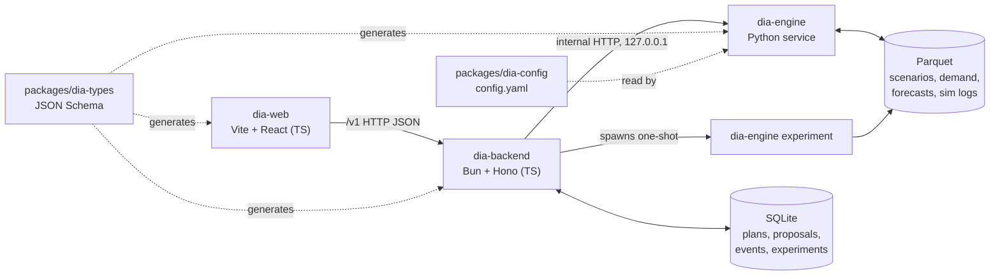

# Architecture.md — Vitaran (DIAgent)

*What* to build: `PRD.md`. *Who* builds it: `Team.md`. This file fixes *how* the parts connect: languages, folders, data, APIs and contracts.

## 1. Shape of the system



| Part | Language | Why | Ships as |
|---|---|---|---|
| `engine/dia-engine` | **Python 3.11** (the only Python) | statsforecast, scipy, PuLP + HiGHS, pandas | `dia-engine` binary (PyInstaller `--onedir`) |
| `apps/dia-backend` | **TypeScript on Bun** | All public APIs, app state, joins web and engine | `dia-server` binary (`bun build --compile`, web embedded) |
| `apps/dia-web` | **TypeScript, React** | Planner, distributor, dispatch and results screens | static files inside `dia-server` |
| `packages/dia-types` | **JSON Schema** | One contract for both languages | generated TS + pydantic |
| `apps/dia-fallback-ui` | Python (Streamlit) | Emergency UI only | not released |

**One pipeline.** The engine service (`POST /plan`) and the simulator both call `dia_engine.optimize.pipeline.make_plan()`. What the judges see live is exactly what was evaluated.

## 2. Folder structure (owner in brackets)

```
.
├── README.md  AGENTS.md  CLAUDE.md        entry points for humans and AI tools
├── .kiro/steering/                         Kiro rules (point to docs/)
├── docs/                                   PRD, Architecture, Rules, Phases, Design, Team, Memory
│   └── team/  M1-kiro-lead.md  M2-claude-lead.md  M3-web-analytics.md  M4-data.md
├── apps/
│   ├── dia-backend/   [M2; src/ai M1]      Hono routes, bun:sqlite repo, engine clients, OpenAPI
│   ├── dia-web/       [M2 core; M3 analytics pages]
│   └── dia-fallback-ui/ [M2]               Streamlit emergency UI
├── engine/dia-engine/src/dia_engine/
│   ├── config.py  store.py  [M2]           config schema, parquet store
│   ├── data/          [M4, backup M2]      generator v0, weather
│   ├── forecast/      [M2]                 forecast, dist, targets
│   ├── baselines/     [M2]                 Baseline A and B
│   ├── optimize/      [M1]                 optimize, freight, validate, explain, pipeline
│   ├── sim/           [M1]                 simulate, kpi, policy
│   ├── service/  cli.py [M1]               internal HTTP service + CLI
│   └── ../tests/                           contract + realism tests
├── packages/
│   ├── dia-types/     [M2; schema changes need M1 too]  schema/ fixtures/ dist/ ts/ py/ scripts/
│   └── dia-config/    [M2 schema, M4 values]  config.yaml  climate.yaml
├── tools/release/     [M1]                 binary builds (next PR: m1/build-release)
├── .github/           [M2; release.yml M1]  ci.yml  CODEOWNERS  PR template
├── package.json  turbo.json  bun.lock      Bun workspaces
└── pyproject.toml  uv.lock  .python-version uv workspace
```

## 3. Tooling

| Need | Tool | Command |
|---|---|---|
| JS install, run, test, compile | **Bun 1.4** | `bun install`, `bun test`, `bun build --compile` |
| Task orchestration | Turborepo | `bun run dev`, `bun run build` |
| Python env, lockfile | **uv** | `uv sync --all-packages` |
| Python tests | pytest | `bun run test:engine` |
| Backend HTTP | Hono on `Bun.serve` | — |
| Backend DB | `bun:sqlite` (built into Bun, embeds in the binary) | — |
| Request validation | Ajv against the bundled JSON Schema | — |
| Engine HTTP | FastAPI + uvicorn (internal only) | `bun run engine` |
| Optimiser | PuLP + HiGHS (CBC fallback) | — |
| Forecast | statsforecast, scipy | — |
| Web | Vite + React 18 | `bun run --cwd apps/dia-web dev` |

Changes from the earlier plan, made while building: plain `bun:sqlite` with SQL migrations instead of Drizzle (fewer moving parts, embeds cleanly in the binary), and Ajv + a route table for OpenAPI instead of `@hono/zod-openapi` (validates against the same JSON Schema the engine uses, no zod copy).

## 4. Shared types (`packages/dia-types`)

```
schema/*.schema.json   SOURCE OF TRUTH (hand-edited; 8 domain files, refs are "#/$defs/Name")
  └─ bun run gen:types
      ├─ dist/dia.schema.json      bundled; backend validates requests with it
      ├─ ts/generated.ts           @dia/types (backend, web)
      └─ py/dia_types/models.py    dia_types (engine), pydantic v2, extra=forbid
fixtures/*.json        valid example of each main object; tests in both languages load them
```

CI fails if generated files are stale (`bun run check:types`) or a fixture breaks the schema. Never edit generated files.

## 5. Data

### Decision: Parquet for analytical data (engine), SQLite for app state (backend). No database server.

| Store | Owner | Holds | Why |
|---|---|---|---|
| Parquet `data/engine/` | engine (`store.py`) | scenarios, demand, weather, forecasts, simulation logs, KPIs, `results.json` | Written once, read in bulk; reproducible by seed |
| SQLite `data/backend/vitaran.db` | backend (`db/repo.ts`) | plans (JSON per version), proposals, plan events, experiment jobs | Changes during the demo; needs transactions and version checks (409) |

PostgreSQL later means changing only `db/repo.ts`. The engine never touches SQLite; the backend never reads parquet (only `results.json`).

Parquet tables and columns: `store.TABLES` in `engine/dia-engine/src/dia_engine/store.py` (`write_table` rejects wrong columns). SQLite schema: `apps/dia-backend/src/db/migrations.ts` (append-only).

## 6. APIs

### 6.1 Public API (`dia-backend`, `/v1`, docs at `/docs`, spec at `/openapi.json`)

| Method & path | Purpose | Body → Response |
|---|---|---|
| `GET /v1/health` | Liveness, engine mode and status | — |
| `GET /v1/scenarios` | Scenario ids | `string[]` |
| `GET /v1/scenarios/{id}/snapshot?as_of=&opening_state=` | Stock state | `Snapshot` |
| `POST /v1/forecasts` | Weekly forecast + backtest | `ForecastRequest` → `ForecastResponse` |
| `POST /v1/plans` | New plan, or new version with `base_plan_id` | `PlanRequest` → `Plan` |
| `GET /v1/plans/{id}?version=` | Plan (latest by default) | `Plan` |
| `POST /v1/plans/{id}/publish` | PROPOSED + one proposal per distributor | `PublishRequest` → `PublishResponse` |
| `GET /v1/plans/{id}/proposals` | Proposal status | `Proposal[]` |
| `GET /v1/plans/{id}/inbox/{dist_id}` | One distributor's message | `Message` |
| `POST /v1/plans/{id}/responses` | Accept / trim / reject + re-solve | `ResponseRequest` → `ResponseResult`; **409** stale version; 422 bad line/qty |
| `GET /v1/plans/{id}/events` | Change log | `PlanEvent[]` |
| `GET /v1/plans/{id}/dispatch?depot=&version=` | Trucks, FEFO pick order | `DispatchResponse` |
| `GET /v1/plans/{id}/dispatch.csv` | Dispatch sheet (UTF-8 BOM) | CSV |
| `POST /v1/experiments` | Start evaluation job (cached by config hash) | `ExperimentRequest` → 202 `ExperimentAccepted` |
| `GET /v1/experiments/{id}` | Job status | `ExperimentInfo` |
| `GET /v1/experiments/{id}/results` | Results (404 until done) | `ExperimentResults` |
| `GET /v1/assumptions` | FR-15 table | `AssumptionRow[]` |

Rules: line ids belong to one version (re-fetch after a response); responses for one plan are serialised by an in-process lock; the 409 check is per distributor; engine 501 passes through as 501 (unbuilt module), engine 422 (validator violation) becomes 500.

### 6.2 Internal engine API (`dia-engine serve`, 127.0.0.1 only; models `Engine*` in dia-types)

`GET /health` · `GET /scenarios` · `GET /scenarios/{id}` · `GET /scenarios/{id}/snapshot` · `GET /scenarios/{id}/backtest` · `POST /forecast` · `POST /plan` · `POST /resolve` · `GET /assumptions`

Experiments do not use HTTP: the backend runs `dia-engine experiment --id EX-… --request req.json`, reads `PROGRESS <pct>` lines, then `DONE` (exit 0), `NOT_IMPLEMENTED` (exit 3) or an error (exit 1), and serves `data/engine/experiments/<id>/results.json`.

### 6.3 Backend engine modes (`ENGINE_MODE`)

| Mode | Engine | Use |
|---|---|---|
| `fake` | fixtures from dia-types, no process | web work, backend tests |
| `source` (default) | `.venv` Python `-m dia_engine.cli serve` | development, CI e2e |
| `binary` | `ENGINE_BIN` executable | release, demo |

### 6.4 External APIs

| API | Used | How |
|---|---|---|
| Open-Meteo archive | Once | `dia-engine weather --fetch` caches real history; offline fallback = `climate.yaml` climatology |
| Vertex AI (`gemini-4-argon`) | Optional, off | `apps/dia-backend/src/ai/` (M1). Explains only; never produces quantities. `AI_ENABLED=false` by default |
| WhatsApp / maps / others | No | Inbox is our own screen; map uses a free MapLibre basemap |

## 7. Engine module contracts

| Function | Owner | Returns | Called by |
|---|---|---|---|
| `data.generate.generate(cfg, seed)` / `load_scenario(id)` | M4/M2 | scenario id / `Scenario` | CLI, service |
| `sim.simulate.get_snapshot(id, as_of, opening_state)` | M1 | `Snapshot` | service |
| `sim.simulate.run_experiment(id, req, progress)` | M1 | writes parquet + results.json | CLI |
| `forecast.forecast.forecast(id, as_of, horizon_days, model)` | M2 | `ForecastBundle` | service, sim |
| `forecast.dist.*` | M2 | window distributions | optimiser (C2, C8) |
| `forecast.targets.compute_targets(...)` | M2 | `Target[]` | pipeline, baselines |
| `baselines.BaselineA/B().plan(...)` | M2 | `Plan` | sim, pipeline fallback |
| `optimize.freight.*` | M1 | INR, (lines, trucks) | optimiser and both baselines |
| `optimize.optimize.solve(OptimizeInput)` | M1 | `SolveOutput` | pipeline only |
| `optimize.explain.add_reasons` / `validate.validate_plan` | M1 | `Plan` / `ValidationReport` | pipeline only |
| `optimize.pipeline.make_plan` / `apply_response` | M1 | validated `Plan` | service, `EnginePolicy` |

## 8. Key decisions
- One network-wide MILP per temperature class; convex piecewise-linear lost-sales and waste curves; feasible by construction; Baseline B fallback if the solver fails.
- All policies share `freight.py`, the forecast and the credit cut, so comparisons are fair.
- Every business parameter lives in `packages/dia-config/config.yaml` with a source or "judgment".
- Simulated data must be realistic (Rules.md); `tests/test_realism.py` guards it.
